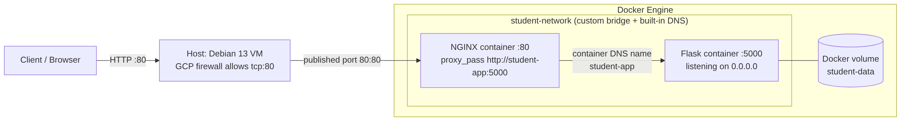

# Flask Deployment Patterns

**One Flask service, deployed two ways on Google Cloud: supervised by `systemd` behind NGINX on a Debian VM, and as a Docker Compose stack. The two are compared on isolation, reproducibility and operability.**

The goal of this repository is to show the engineering trade-offs between running a service directly on a host and running it in containers, with working configuration, documented design decisions, and an honest list of what is not production-ready yet.



## Contents

| Path | What it is |
|---|---|
| [`linux-flask-deployment/`](linux-flask-deployment/) | Host-based deployment: unprivileged service user, virtualenv, `systemd` unit with restart policy, NGINX reverse proxy |
| [`docker-flask-nginx/`](docker-flask-nginx/) | Containerised deployment: Dockerfile, Compose stack, user-defined network, named volume, NGINX reverse proxy |
| [`docker-flask-nginx/docs/implementation-notes.md`](docker-flask-nginx/docs/implementation-notes.md) | Detailed implementation notes: every command with output, screenshots, failures and fixes |

## Quick start (containerised stack)

Requirements: Docker Engine with the Compose plugin, and port 80 free on the host.

```bash
git clone https://github.com/justherozy/flask-deployment-patterns.git
cd flask-deployment-patterns/docker-flask-nginx
docker compose up -d --build
curl -i http://localhost/          # 200, "Hello from my Docker container! Environment:production"
curl -i http://localhost/health    # 200, {"status": "healthy"}
docker compose down                # stop and remove containers (the named volume is kept)
```

## Two deployment models compared

| Concern | Host-based (`systemd` + NGINX) | Containerised (Compose) |
|---|---|---|
| Process supervision | `systemd` with `Restart=always` | Docker restart policy `unless-stopped` |
| Isolation | Dedicated unprivileged user; shared host filesystem and network | Separate filesystem, network namespace and process tree per container |
| Dependencies | Python virtualenv under `/opt`; host packages shared with other services | Pinned to the image; the host needs only Docker |
| Reproducibility | Manual or scripted setup per machine | `docker compose up --build` on any host with Docker |
| Service discovery | Loopback address and fixed port (`127.0.0.1:5000`) | Container DNS on a user-defined network (`student-app:5000`) |
| Exposure | NGINX on :80; Flask bound to loopback | Only NGINX publishes a port; Flask is reachable solely through the network |
| State | Host filesystem | Named volume (`student-data`), separate from the container lifecycle |
| Logs | `journalctl -u student-app` | `docker compose logs` |
| Rollback | Restore previous files and restart the unit | Redeploy a previous image tag (tags are not versioned yet, see limitations) |

## Design decisions

| Decision | Reason | Trade-off |
|---|---|---|
| Flask binds `127.0.0.1` on the host, `0.0.0.0` in the container | On the host, only NGINX should reach the app. In a container, `127.0.0.1` is the container's own loopback, so Docker's forwarded traffic could never reach it | The container address is reachable by anything on the Docker network, which is why that network is user-defined and holds only this stack |
| Only NGINX publishes a port | Smallest possible attack surface; one place to add TLS and rate limiting later | Direct debugging of Flask needs `docker exec` or a temporary port mapping |
| User-defined bridge network instead of the default bridge | Built-in DNS by service name, so no hard-coded container IPs | Names are part of the contract: renaming `student-app` breaks the NGINX upstream |
| Named volume for `/data` | State survives `docker rm` and image rebuilds | Volumes are host-local; they are not a backup strategy |
| NGINX config bind-mounted read-only | Change the proxy without rebuilding an image | The file must exist on the host, so the stack is not a single self-contained artifact |
| `restart: unless-stopped` | Recovers from crashes and host reboots without restarting containers an operator stopped on purpose | A crash loop restarts indefinitely; check `RestartCount` |
| `depends_on` without a health check | Orders container start | It does not wait for readiness. A request in the first seconds after `up` can fail while Flask starts (the `curl: (56)` reset documented in the implementation notes) |

## Known limitations and hardening roadmap

This is a reference deployment, not a hardened production service. These are the gaps between it and a production service, in priority order:

1. **Application server.** Flask's development server is used. Replace it with `gunicorn` behind NGINX.
2. **Container user.** The Flask container runs as root. Add a non-root `USER` to the Dockerfile.
3. **Readiness.** Add a Compose `healthcheck` on `/health` and use `depends_on: condition: service_healthy`.
4. **Image hygiene.** Pin base images and dependencies (`python:3.12-slim`, `nginx`, `flask` are not version-locked), add a `.dockerignore`, scan images with Trivy.
5. **Transport security.** Terminate TLS at NGINX with a certificate (Let's Encrypt) and redirect HTTP to HTTPS.
6. **Automation.** CI pipeline that builds, scans and tests the image on every push; image tags tied to commits for rollback.
7. **Provisioning.** Describe the VM and firewall rules as code (Terraform) instead of console clicks.
8. **Orchestration.** Deploy the same service on Kubernetes (Deployment, Service, Ingress, probes).

## Repository layout

```
.
├── linux-flask-deployment/
│   ├── app.py                     # Flask application (binds 127.0.0.1:5000)
│   ├── student-app.service        # systemd unit
│   ├── nginx-student-app.conf     # NGINX reverse proxy site
│   └── requirements.txt
└── docker-flask-nginx/
    ├── app.py                     # Flask application (binds 0.0.0.0:5000)
    ├── Dockerfile
    ├── compose.yaml
    ├── nginx/default.conf
    ├── diagrams/
    ├── screenshots/               # evidence referenced by the implementation notes
    └── docs/implementation-notes.md
```

## Environment

Google Compute Engine VM, Debian 13, Docker Engine and Docker Compose, NGINX, Python 3.12 (container image) and Flask.

## Author

**Henry Oribe**: [github.com/justherozy](https://github.com/justherozy)

Released under the [MIT License](LICENSE).
