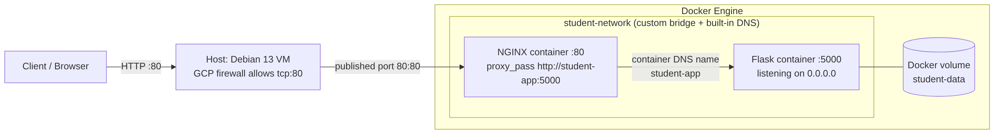

# Containerised deployment: Flask behind NGINX with Docker Compose

A two-container stack defined in one Compose file: a Flask application and an NGINX reverse proxy on a user-defined network, with a named volume for application data. Only NGINX is published to the host.



## Run it

Requirements: Docker Engine with the Compose plugin; port 80 free on the host.

```bash
docker compose up -d --build
curl -i http://localhost/          # 200 "Hello from my Docker container! Environment:production"
curl -i http://localhost/health    # 200 {"status": "healthy"}
docker compose ps                  # both services Up
docker compose down                # remove containers and network; the volume is kept
```

On a cloud VM, allow inbound `tcp:80` in the firewall (on GCP, a VPC firewall rule) to reach it from a browser.

## Stack

| Service | Image | Role | Network exposure |
|---|---|---|---|
| `app` (container `student-app`) | Built from `./Dockerfile` (`python:3.12-slim`) | Flask on `0.0.0.0:5000`; `APP_ENV` read from the environment; `/data` on a named volume | None published; reachable only on `student-network` |
| `nginx` | `nginx` | Reverse proxy; forwards to `http://student-app:5000` using Docker DNS | Publishes `80:80` |

Shared resources: network `student-network` (user-defined bridge with DNS), volume `student-data`, restart policy `unless-stopped` on both services.

## How the Dockerfile is built

```dockerfile
FROM python:3.12-slim
WORKDIR /app
COPY requirements.txt .
RUN pip install --no-cache-dir -r requirements.txt
COPY app.py .
EXPOSE 5000
CMD ["python", "app.py"]
```

- `requirements.txt` is copied and installed **before** the application code, so editing `app.py` reuses the cached dependency layer and rebuilds in seconds (demonstrated in the learning log).
- `--no-cache-dir` keeps pip's download cache out of the image.
- `EXPOSE` only documents the port; publishing is done by `ports:` in Compose.

## Operations

```bash
docker compose logs -f app                       # application logs
docker compose logs nginx --tail 20              # proxy access and error logs
docker compose ps -a                             # states and exit codes
docker exec nginx getent hosts student-app       # does the proxy resolve the app by name?
docker exec nginx wget -qO- http://student-app:5000   # can the proxy reach the app?
docker inspect -f '{{.State.ExitCode}} {{.RestartCount}}' student-app
docker volume inspect student-app_student-data   # volume name is prefixed with the project name
```

## Troubleshooting runbook

Work from the outside in: client, published port, proxy, network, application.

| Symptom | Likely cause | Check | Status |
|---|---|---|---|
| `curl: (56)` / connection reset in the first seconds after `up` | Flask not listening yet; `depends_on` orders start, not readiness | `docker compose logs app`, retry after a few seconds | Reproduced, in the learning log |
| `curl: (7) Failed to connect` on `localhost:5000` | Port never published (`-p` missing or `ports:` absent) | `docker ps` shows `5000/tcp` without a host mapping | Reproduced, in the learning log |
| Data gone after `docker rm` | Written to the container's writable layer, not a volume | Mount a volume at the write path | Reproduced, in the learning log |
| `502 Bad Gateway` from NGINX | Proxy is healthy, upstream is down or unreachable | `docker compose ps`, `docker compose logs app`, `docker exec nginx wget -qO- http://student-app:5000` | Procedure documented, evidence being added |
| `host not found in upstream` in NGINX logs | Upstream name is not a service/container name on the network | `docker exec nginx getent hosts <name>` | Procedure documented, evidence being added |
| Published port works from the VM but connection resets | App bound to `127.0.0.1` inside the container | `docker logs` shows `Running on http://127.0.0.1:5000` only | Procedure documented, evidence being added |
| `port is already allocated` | Another process or container holds the host port | `ss -lntp \| grep :80` or `docker ps` | Procedure documented, evidence being added |

## Known limitations

Development server instead of `gunicorn`; container runs as root; no health check; unpinned base images and dependencies; no `.dockerignore`; no TLS; static container names. The prioritised hardening plan is in the [repository README](../README.md#known-limitations-and-hardening-roadmap).

## Further reading

[`docs/learning-log.md`](docs/learning-log.md) is the full lab notebook for this project: 17 hands-on tasks with commands, explanations and 39 screenshots, the problems encountered and how they were fixed, a Linux-versus-Docker comparison, and a 35-question knowledge check.
