# Implementation notes: containerising a Flask service with NGINX and Docker Compose

> **Docker did not make Linux disappear.** A container is still a Linux process. Docker uses kernel features (namespaces and cgroups) to isolate it, then adds tooling for images, networking, storage and lifecycle management.

These are the working notes for the containerised deployment: what was built, every command with an explanation of its parts, the real output (with screenshots), the failures encountered and how each was diagnosed and fixed. The concise overview is in the [project README](../README.md).

**Summary:** take the Flask service from the host-based deployment, package it as a Docker image, run it as a container, put NGINX in front of it as a second container on a custom network, add persistent storage, and define the whole thing in Docker Compose.

---

## Contents

1. [Project overview and key takeaways](#1-project-overview-and-key-takeaways)
2. [Environment and preparation](#2-environment-and-preparation)
3. [Architecture diagrams](#3-architecture-diagrams)
4. [The project files, explained line by line](#4-the-project-files-explained-line-by-line)
5. [Step-by-step walkthrough, Tasks 1 to 17](#5-step-by-step-walkthrough-tasks-1-to-17)
6. [Linux project vs Docker project](#6-linux-project-vs-docker-project)
7. [Troubleshooting](#7-troubleshooting)
8. [Command cheat sheet](#8-command-cheat-sheet)
9. [Glossary](#9-glossary)

> **A note on the screenshots.** They are photos of my screen, so some have glare or an angle. Each one is placed under the step it proves, with a caption saying what to look at.

---

## 1. Project overview and key takeaways

**Scenario.** The Flask service had been deployed directly on a Linux host, with Python, a virtual environment, `systemd`, networking and NGINX all managed by hand ([host-based deployment](../../linux-flask-deployment/)). The goal here is to package the same service as container images so it deploys identically on any Docker host.

**Request flow, first version:**

```
Client → Linux server :5000 → Docker port mapping → container :5000 → Flask
```

**Request flow, final version:**

```
Client → :80 → NGINX container → Docker network (DNS) → Flask container :5000
```

**Key takeaways:**

| Topic | Takeaway |
|---|---|
| Containers | A container is an isolated Linux process on the host kernel, not a tiny VM |
| Images | A stack of read-only layers built from a Dockerfile; containers are running instances |
| Caching | Instruction order matters; dependencies first, code last |
| Ports | `-p HOST:CONTAINER` publishes a port; `EXPOSE` only documents it |
| Networking | Custom networks give containers DNS by name; never hard-code container IPs |
| Storage | The container's writable layer is disposable; volumes persist |
| Logs | Apps write to stdout/stderr; `docker logs` reads them |
| Restart | `--restart unless-stopped` is the Docker equivalent of `Restart=always` |
| Compose | One YAML file replaces many long `docker run` commands |
| Troubleshooting | Work from the outside in: client, host port, NGINX, DNS, container, process |

---

## 2. Environment and preparation

| Item | Value |
|---|---|
| Cloud | Google Cloud Compute Engine VM, zone `europe-west2-b` |
| OS | **Debian GNU/Linux 13 (trixie)**. The brief says Ubuntu, but GCP's default image is Debian |
| Kernel | `6.12.x+deb13-cloud-amd64` |
| Resources | 8 vCPUs, about 31 GiB memory (shown by `docker info`) |
| Access | SSH-in-browser (Google Cloud Console), working as `root` after `sudo -i` |
| Docker | Docker Engine (`docker-ce`) with `containerd`, Buildx and the Compose plugin |

### 2.1 Firewall: allowing port 80 (GCP)

After restarting the VM, opening the VM's external IP in my browser timed out. The server was healthy (`curl localhost` worked), so the block was the Google Cloud firewall.

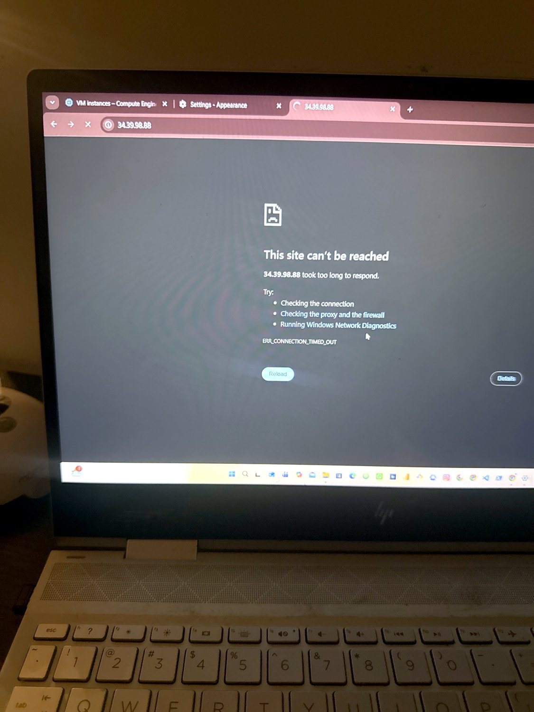
*Figure 2.1: `ERR_CONNECTION_TIMED_OUT`. A timeout (instead of "connection refused") means the request never reached the VM.*

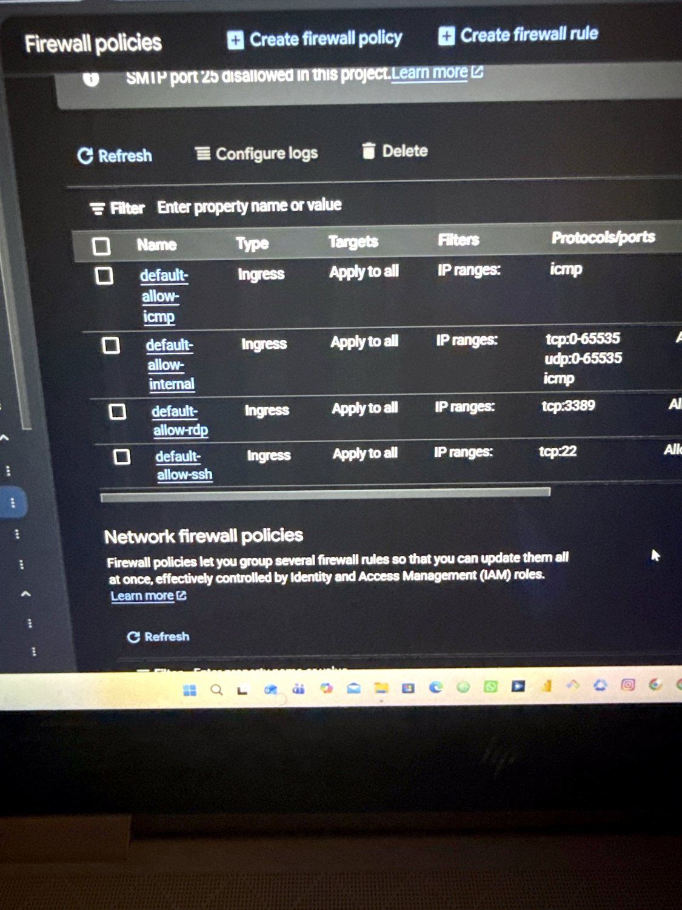
*Figure 2.2: The firewall list had rules for ICMP, internal traffic, RDP (3389) and SSH (22), but **none for port 80**.*

**Fix:** create a firewall rule (name `allow-http`, ingress, allow, target tag `http-server`, source `0.0.0.0/0`, protocol `tcp:80`) and make sure the VM has the `http-server` tag (VM → Edit → tick *Allow HTTP traffic*).

| Setting | Meaning |
|---|---|
| Ingress | Traffic coming **into** the VM |
| Target tags | The rule applies only to VMs carrying the `http-server` tag |
| Source `0.0.0.0/0` | Allow from anywhere on the internet |
| `tcp:80` | Only web (HTTP) traffic |

### 2.2 Freeing ports 80 and 5000 (stopping the Linux project)

The Linux project's `student-app` service (port 5000) and host NGINX (port 80) would clash with Docker, because Docker will publish the same host ports. Two things cannot bind the same host port.

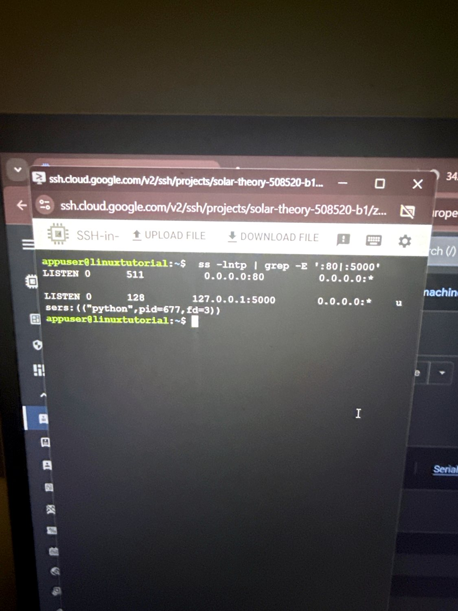
*Figure 2.3: Before stopping. `ss -lntp` shows something listening on `0.0.0.0:80` (NGINX) and `127.0.0.1:5000` (python, pid 677).*

| Command | What it does |
|---|---|
| `ss -lntp \| grep -E ':80\|:5000'` | `ss` lists sockets. `-l` listening only, `-n` numeric ports, `-t` TCP, `-p` show the process. `grep -E` filters lines containing `:80` **or** `:5000` |
| `sudo systemctl stop student-app nginx` | Stop both services right now, freeing their ports |
| `sudo systemctl disable student-app nginx` | Remove the "start at boot" link, so they do not come back after a reboot |

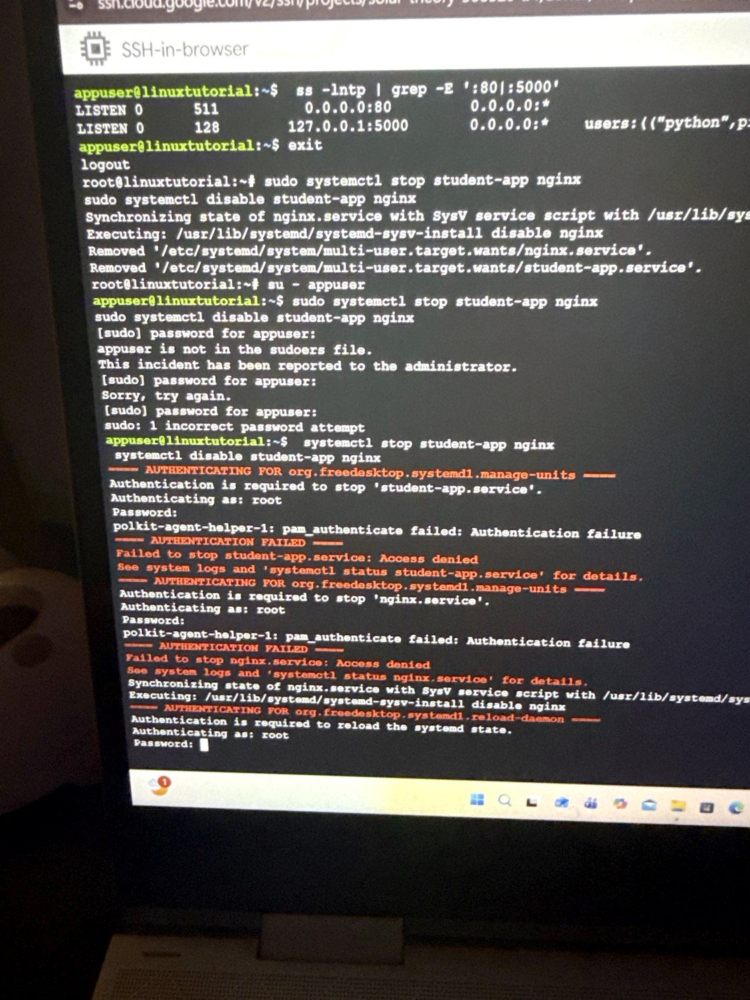
*Figure 2.4: The commands worked as `root` (`Removed '/etc/systemd/system/multi-user.target.wants/...'`). Afterwards I switched to `appuser` by mistake; `appuser is not in the sudoers file` is expected because `appuser` is deliberately unprivileged (least privilege).*

Nothing was deleted, so the Linux project can be restored any time:

```bash
systemctl enable --now student-app nginx
```

(`enable --now` = enable at boot **and** start immediately.)

### 2.3 Confirming the OS and that the ports are free

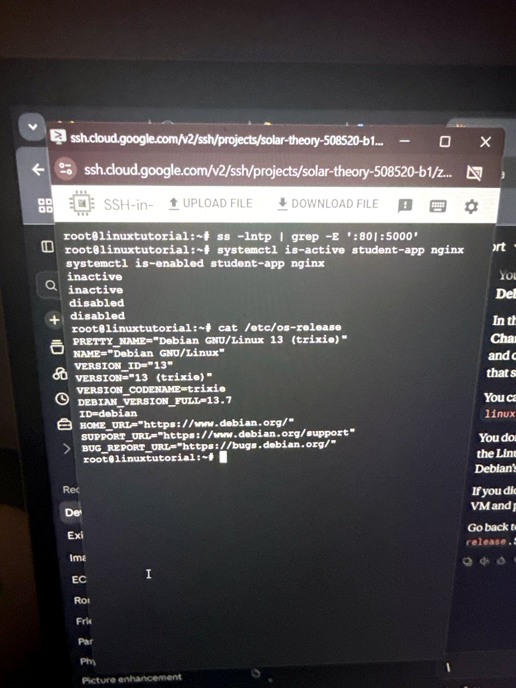
*Figure 2.5: `systemctl is-active` shows `inactive inactive`, `is-enabled` shows `disabled disabled`, the port check printed nothing (ports free), and `/etc/os-release` confirms **Debian 13 (trixie)**.*

| Command | What it does |
|---|---|
| `systemctl is-active student-app nginx` | Prints `active`/`inactive` for each service |
| `systemctl is-enabled student-app nginx` | Prints `enabled`/`disabled` (starts at boot or not) |
| `cat /etc/os-release` | Prints OS identity. `VERSION_CODENAME=trixie` is used in the Docker repo setup |

**Why Debian vs Ubuntu matters:** both use `apt`, `systemd` and the same commands, but Docker has **separate package repositories**: `download.docker.com/linux/debian` and `.../linux/ubuntu`. Using the wrong one fails.

---

## 3. Architecture diagrams

### 3.1 Final architecture

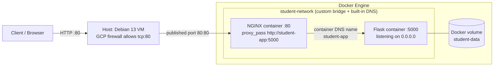
*Figure 3.1: Only NGINX publishes a host port (`80:80`). Flask has none, so it is reachable only through NGINX over the custom network.*

### 3.2 A request, step by step

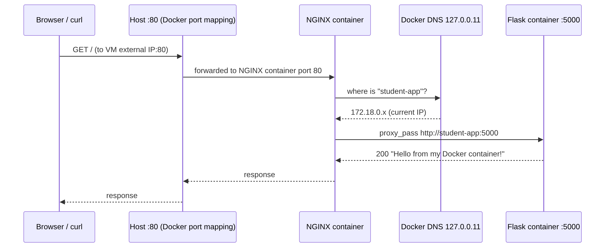
*Figure 3.2: The full request path. NGINX asks Docker's built-in DNS (127.0.0.11) for the IP of `student-app`, then proxies the request to it.*

### 3.3 Docker CLI, daemon and socket

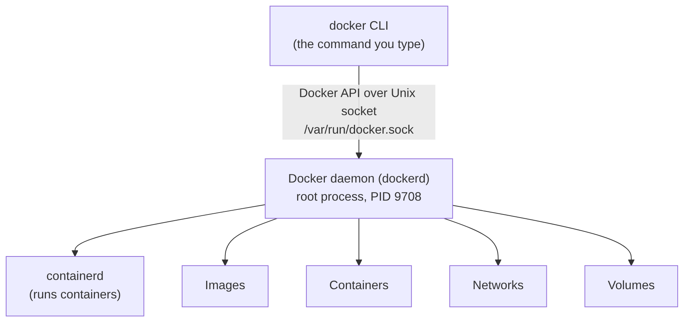
*Figure 3.3: The `docker` command is only a client. The daemon does the work.*

### 3.4 Dockerfile → image → containers

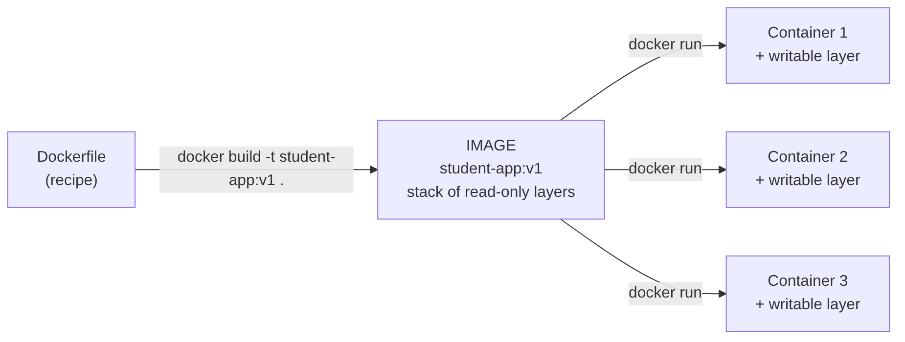
*Figure 3.4: One image can create many containers.*

### 3.5 Image layers and the writable layer

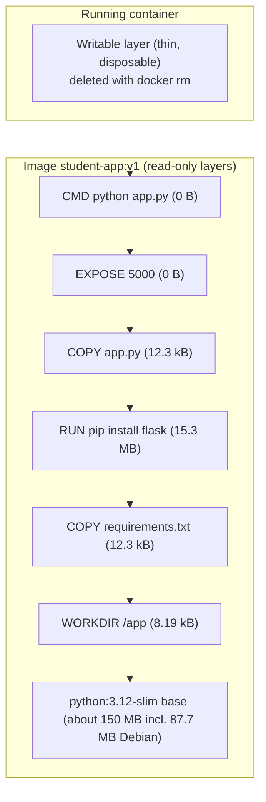
*Figure 3.5: These are the real layers and sizes from my `docker history` output. The writable layer is what disappears when a container is removed.*

### 3.6 Containers vs virtual machines

```
Virtual machines                         Containers
┌────────┐ ┌────────┐                   ┌────────┐ ┌────────┐
│  App   │ │  App   │                   │  App   │ │  App   │
├────────┤ ├────────┤                   ├────────┤ ├────────┤
│Guest OS│ │Guest OS│                   │ Libs   │ │ Libs   │
├────────┴─┴────────┤                   ├────────┴─┴────────┤
│    Hypervisor     │                   │  Container engine │
├───────────────────┤                   ├───────────────────┤
│  Host OS + HW     │                   │ Host OS (1 kernel)│
└───────────────────┘                   └───────────────────┘
Each VM has its own kernel.             All containers share the host kernel.
```

---

## 4. The project files, explained line by line

```
student-app/
├── app.py
├── requirements.txt
├── Dockerfile
├── compose.yaml
└── nginx/
    └── default.conf
```

### 4.1 `app.py`

```python
from flask import Flask
import os

app = Flask(__name__)
APP_ENV = os.getenv("APP_ENV", "development")

@app.route("/")
def home():
    return f"Hello from my Docker container! Environment:{APP_ENV}"

@app.route("/health")
def health():
    return {"status": "healthy"}

if __name__ == "__main__":
    app.run(
        host="0.0.0.0",
        port=int(os.getenv("PORT", "5000"))
    )
```

| Line | Meaning |
|---|---|
| `from flask import Flask` | Import the Flask web framework |
| `import os` | Needed to read environment variables |
| `app = Flask(__name__)` | Create the application object |
| `APP_ENV = os.getenv("APP_ENV", "development")` | Read the variable `APP_ENV`; if it is not set, use `"development"`. This is **runtime configuration** |
| `@app.route("/")` | When someone requests `/`, run the function below |
| `f"...{APP_ENV}"` | An **f-string**: the leading `f` makes Python replace `{APP_ENV}` with its value. Without the `f`, the text `{APP_ENV}` would be printed literally |
| `@app.route("/health")` | A health-check endpoint returning JSON `{"status": "healthy"}` |
| `if __name__ == "__main__":` | Run the server only when the file is executed directly |
| `host="0.0.0.0"` | Listen on **all network interfaces** inside the container (see Q14) |
| `port=int(os.getenv("PORT", "5000"))` | Port comes from the `PORT` variable, default 5000 |

**The key change from the Linux project:** `127.0.0.1` became `0.0.0.0`.

### 4.2 `requirements.txt`

```
flask
```
The list of Python packages the app needs. The image build installs them automatically, replacing `pip install flask` inside a venv from Project 1.

### 4.3 `Dockerfile`

```dockerfile
FROM python:3.12-slim
WORKDIR /app
COPY requirements.txt .
RUN pip install --no-cache-dir -r requirements.txt
COPY app.py .
EXPOSE 5000
CMD ["python", "app.py"]
```

| Instruction | What it does | Linux-project equivalent |
|---|---|---|
| `FROM python:3.12-slim` | Start from an existing image that already has Python. `slim` is a smaller Debian-based variant | `apt install python3` |
| `WORKDIR /app` | Set (and create) the working directory inside the image; later instructions run from here | `cd /opt/student-app` |
| `COPY requirements.txt .` | Copy the file from my folder (the **build context**) into `/app`. The `.` means the current directory, `/app` | Putting the file on the server |
| `RUN pip install --no-cache-dir -r requirements.txt` | Run a command **at build time**. `-r` reads package names from a file. `--no-cache-dir` stops pip keeping download files, keeping the image smaller | `pip install flask` in the venv |
| `COPY app.py .` | Copy the application code | Creating `app.py` |
| `EXPOSE 5000` | **Documentation only.** Records that the app uses port 5000. Does **not** publish it | none |
| `CMD ["python", "app.py"]` | The command that runs **when a container starts** | `ExecStart=` in the systemd file |

**Why `requirements.txt` is copied before `app.py`:** Docker caches each layer, top to bottom. Dependencies rarely change and code changes often, so installing dependencies first means a code edit does not reinstall Flask.

### 4.4 `nginx/default.conf`

```nginx
server {
    listen 80;

    location / {
        proxy_pass http://student-app:5000;
        proxy_set_header Host $host;
        proxy_set_header X-Real-IP $remote_addr;
    }
}
```

| Line | Meaning |
|---|---|
| `server { ... }` | One website / virtual host |
| `listen 80;` | Accept connections on port 80 **inside the NGINX container** |
| `location / { ... }` | Applies to every request path |
| `proxy_pass http://student-app:5000;` | **The reverse-proxy line.** Forward the request to host `student-app` port 5000. Docker DNS turns the name into Flask's current IP |
| `proxy_set_header Host $host;` | Pass the original `Host` header to Flask |
| `proxy_set_header X-Real-IP $remote_addr;` | Tell Flask the real client's IP, otherwise it only sees NGINX's |

Compared with the Linux project, the only change is `127.0.0.1:5000` → `student-app:5000`.

### 4.5 `compose.yaml`

```yaml
services:
  app:
    build: .
    container_name: student-app
    environment:
      APP_ENV: production
    volumes:
      - student-data:/data
    restart: unless-stopped
    networks:
      - student-network

  nginx:
    image: nginx
    container_name: nginx
    ports:
      - "80:80"
    volumes:
      - ./nginx/default.conf:/etc/nginx/conf.d/default.conf:ro
    depends_on:
      - app
    restart: unless-stopped
    networks:
      - student-network

volumes:
  student-data:

networks:
  student-network:
```

| Key | Meaning |
|---|---|
| `services:` | The containers to run: `app` (Flask) and `nginx` |
| `build: .` | **Build** an image from the Dockerfile in this folder (Compose names it `student-app-app`) |
| `image: nginx` | **Pull** a ready-made image; no build |
| `container_name:` | Fixes the container name so DNS name `student-app` matches `default.conf` |
| `environment:` | Same as `-e` on `docker run` |
| `volumes:` (in a service) | Mounts. `student-data:/data` is a **volume**; `./nginx/default.conf:...:ro` is a **bind mount**, read-only |
| `ports: "80:80"` | Same as `-p 80:80`. Only NGINX has it, so Flask is not published |
| `depends_on:` | Start `app` before `nginx` |
| `restart: unless-stopped` | Same as `--restart unless-stopped` |
| `networks:` | Attach to `student-network` so both containers share DNS |
| `volumes:` (top level) | Declares the named volume. Compose creates it on first `up` as `student-app_student-data` (project-name prefix) |

| `docker run` option | Compose equivalent |
|---|---|
| `--name student-app` | `container_name: student-app` |
| `-p 80:80` | `ports: - "80:80"` |
| `-e APP_ENV=production` | `environment: APP_ENV: production` |
| `-v student-data:/data` | `volumes: - student-data:/data` |
| `--restart unless-stopped` | `restart: unless-stopped` |
| `--network student-network` | `networks: - student-network` |
| `docker build -t ... .` | `build: .` |

---

## 5. Step-by-step walkthrough, Tasks 1 to 17

### Task 1: Install Docker and inspect the daemon

**Goal:** install Docker and understand the CLI, the daemon and the socket.

#### Commands (run as root; add `sudo` in front if you are a normal user)

**Step 1: prerequisites**
```bash
apt update
apt install -y ca-certificates curl
```
| Part | Meaning |
|---|---|
| `apt update` | Refresh the list of available packages (installs nothing) |
| `apt install -y` | Install packages; `-y` answers "yes" to the prompt |
| `ca-certificates` | Lets the server verify HTTPS sites are genuine |
| `curl` | Downloads files from the internet |

**Step 2: add Docker's signing key**
```bash
install -m 0755 -d /etc/apt/keyrings
curl -fsSL https://download.docker.com/linux/debian/gpg -o /etc/apt/keyrings/docker.asc
chmod a+r /etc/apt/keyrings/docker.asc
```
| Part | Meaning |
|---|---|
| `install -m 0755 -d /etc/apt/keyrings` | Here `install` creates a **directory** (`-d`) with permissions `755` (owner full, others read/execute) |
| `curl -fsSL ... -o file` | `-f` fail on errors, `-s` quiet, `-S` still show errors, `-L` follow redirects, `-o` save to a file |
| The key | Lets `apt` verify packages really came from Docker and were not tampered with (supply-chain security) |
| `chmod a+r` | Make the key readable by all users so `apt` can use it |

**Step 3: add Docker's repository for Debian**
```bash
tee /etc/apt/sources.list.d/docker.sources <<EOF
Types: deb
URIs: https://download.docker.com/linux/debian
Suites: $(. /etc/os-release && echo "$VERSION_CODENAME")
Components: stable
Signed-By: /etc/apt/keyrings/docker.asc
EOF
```
| Part | Meaning |
|---|---|
| `tee file <<EOF ... EOF` | Write the lines between the `EOF` markers into the file |
| `URIs:` | The package source. **Debian vs Ubuntu is decided here** (`/debian`) |
| `$(. /etc/os-release && echo "$VERSION_CODENAME")` | Reads the OS file and prints `trixie`, so I do not type it |
| `Signed-By:` | Only trust packages signed by the key from Step 2 |

**Step 4: install Docker**
```bash
apt update
apt install -y docker-ce docker-ce-cli containerd.io docker-buildx-plugin docker-compose-plugin
```
| Package | What it is |
|---|---|
| `docker-ce` | The Docker **daemon** (`dockerd`), the background service |
| `docker-ce-cli` | The `docker` **command** |
| `containerd.io` | The lower-level runtime the daemon uses to run containers |
| `docker-buildx-plugin` | The modern image builder behind `docker build` |
| `docker-compose-plugin` | Adds `docker compose` (used in Task 17) |

**Step 5: verify**
```bash
docker --version
docker info
systemctl status docker
ps aux | grep dockerd
ls -l /var/run/docker.sock
```
| Command | What it proves |
|---|---|
| `docker --version` | The CLI is installed (works even if the daemon is down) |
| `docker info` | CLI → daemon communication works; shows root dir, CPUs, memory, firewall backend |
| `systemctl status docker` | systemd manages Docker the same way it managed `student-app` |
| `ps aux \| grep dockerd` | The daemon is an ordinary process with a PID. The `grep dockerd` line itself is noise |
| `ls -l /var/run/docker.sock` | The socket file the CLI uses to reach the daemon |

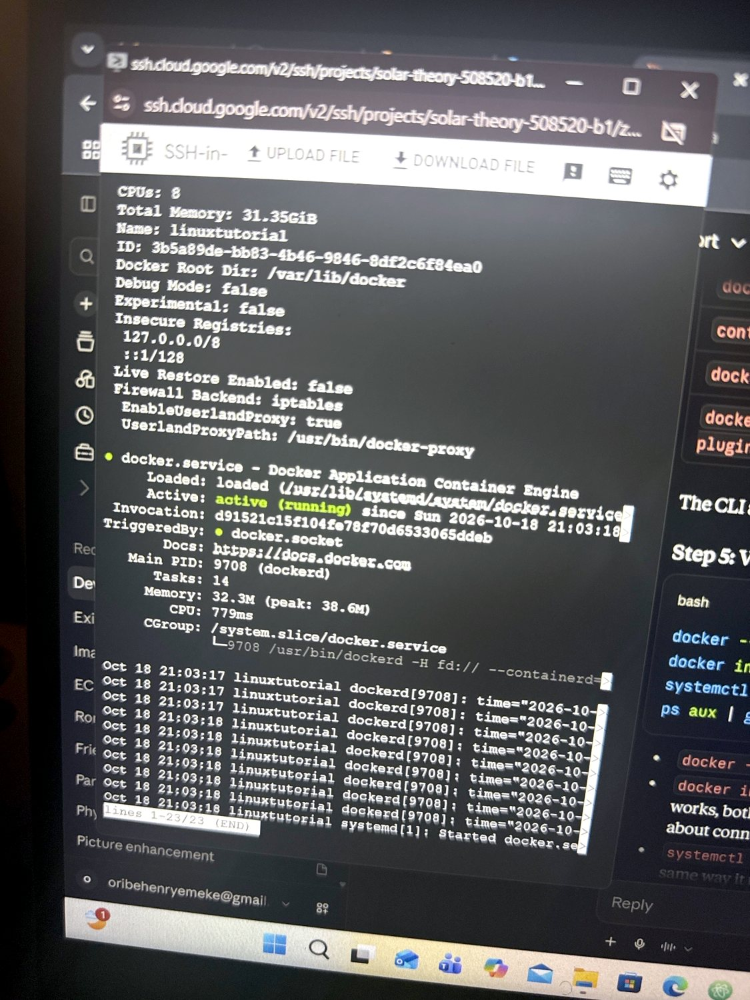
*Figure 5.1: `docker info` shows **CPUs 8**, **Total Memory 31.35GiB**, **Docker Root Dir: /var/lib/docker**, **Firewall Backend: iptables**. `systemctl status` shows `active (running)`, **Main PID 9708 (dockerd)**, `TriggeredBy: docker.socket`, and a `CGroup` of `/system.slice/docker.service`.*

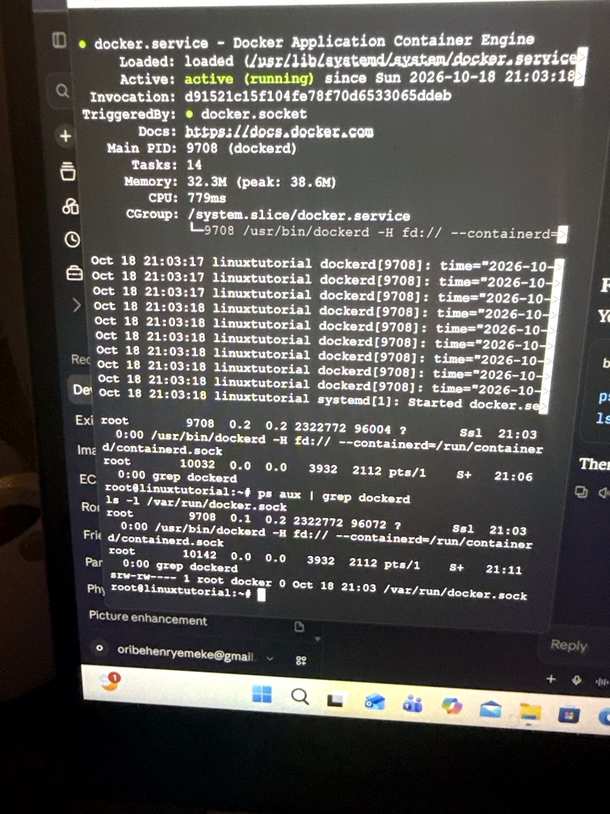
*Figure 5.2: `/usr/bin/dockerd -H fd:// --containerd=/run/containerd/containerd.sock` runs as **root** with PID **9708**. The socket line `srw-rw---- 1 root docker 0 ... /var/run/docker.sock` starts with **s** (a socket); only `root` and the `docker` group can use it.*

**Reading the output:**
- `-H fd://` means the daemon listens on a socket handed to it by systemd (`docker.socket`).
- `--containerd=...` shows `dockerd` talks to `containerd` over another socket.
- `rw-rw----` = owner and group can read/write; others nothing. That is why `docker` commands need root or membership of the `docker` group.
- Size `0` because a socket carries messages, not data.

**Takeaway**
```
docker CLI  →  /var/run/docker.sock  →  Docker daemon (dockerd)
 (client)        (Docker API)             (does the work)
```

---

### Task 2: Run my first containers

**Commands**
```bash
docker run hello-world
docker images
docker ps
docker ps -a
docker run -d --name web nginx
docker ps
docker logs web
docker inspect web
docker stop web
docker ps -a
docker rm web
docker ps -a
```

| Command | What it does |
|---|---|
| `docker run hello-world` | Pull the image if missing, create a container, start it. It prints a message and exits |
| `docker images` | List images stored locally |
| `docker ps` | List **running** containers |
| `docker ps -a` | List **all** containers, including stopped ones |
| `docker run -d --name web nginx` | `-d` = detached (background). `--name web` = my own name. `nginx` = the image |
| `docker logs web` | Show what the container printed to stdout/stderr |
| `docker inspect web` | Print full configuration as JSON (`State`, `NetworkSettings`, `Pid`...) |
| `docker stop web` | Gracefully stop it (it still exists as `Exited`) |
| `docker rm web` | Delete the stopped container |

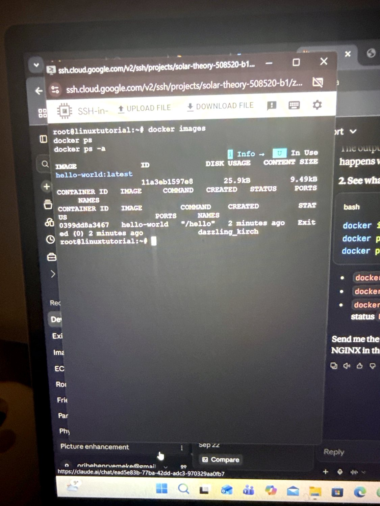
*Figure 5.3: `hello-world:latest` is only about 26 kB. `docker ps` printed only headings (nothing running). `docker ps -a` shows `"/hello"` with status **Exited (0)** and a made-up name, `dazzling_kirch`.*

**Reading `docker ps -a`:**
- **Container ID** is a unique ID. **Image** is the template used.
- **Command** `"/hello"` is the one process the container ran. A container is just that process in isolation.
- **Exited (0)**: `0` means success; any other number means an error (used in the crash challenge).
- **Names** is random unless I use `--name`.

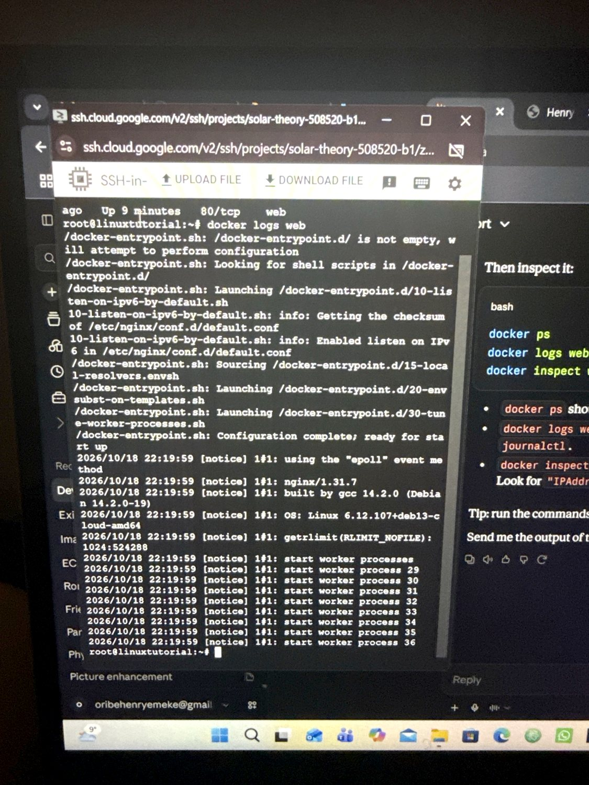
*Figure 5.4: `docker logs web`. The line `OS: Linux 6.12.107+deb13-cloud-amd64` is the **VM's kernel**, proof containers share the host kernel. NGINX started **8 worker processes**, one per VM CPU.*

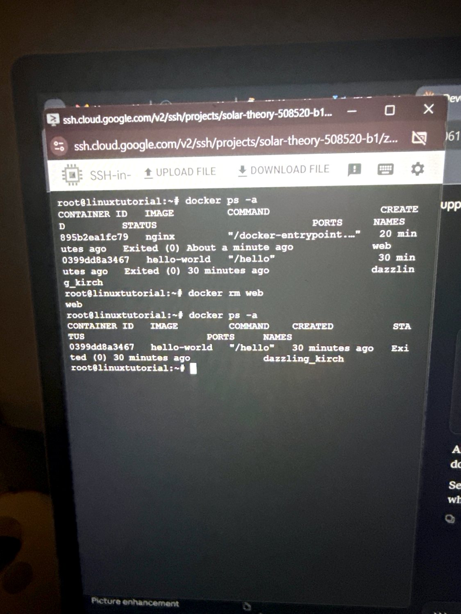
*Figure 5.5: After `docker stop web` the container is `Exited (0)` but still listed. After `docker rm web` it is gone.*

#### `run` vs `start` vs `stop` vs `rm`

| Command | Effect | Analogy from Project 1 |
|---|---|---|
| `docker run` | Creates a **new** container from an image **and** starts it | Installing and starting a new service |
| `docker start` | Starts an **existing** stopped container | `systemctl start` |
| `docker stop` | Stops a running container; it still exists | `systemctl stop` |
| `docker rm` | **Deletes** a stopped container and its writable layer | Deleting the service |

`docker stop` sends a termination signal first so the app can shut down cleanly, and forces it after 10 seconds. `docker kill` forces immediately.

**What happens when `docker run` executes:**
1. The CLI sends the request to the daemon over `/var/run/docker.sock`.
2. The daemon looks for the image locally; not found.
3. It **pulls** the image from Docker Hub.
4. It **creates** a container (writable layer, namespaces, network).
5. It **starts** the container's main process.
6. When that process ends, the container stops (but still exists).

---

### Task 3: Image vs container

**Commands**
```bash
docker run -d --name web1 nginx
docker run -d --name web2 nginx
docker run -d --name web3 nginx
docker images
docker ps
docker exec web1 touch /tmp/only-in-web1.txt
docker exec web1 ls /tmp
docker exec web2 ls /tmp
docker rm -f web1 web2 web3
```

| Command | What it does |
|---|---|
| `docker run -d --name webN nginx` (×3) | Three containers from the **same** image |
| `docker exec web1 touch /tmp/only-in-web1.txt` | Run `touch` (create an empty file) **inside** the running container `web1` |
| `docker exec web1 ls /tmp` / `web2 ls /tmp` | List `/tmp` in each container |
| `docker rm -f web1 web2 web3` | `-f` force: remove them even though they are running |

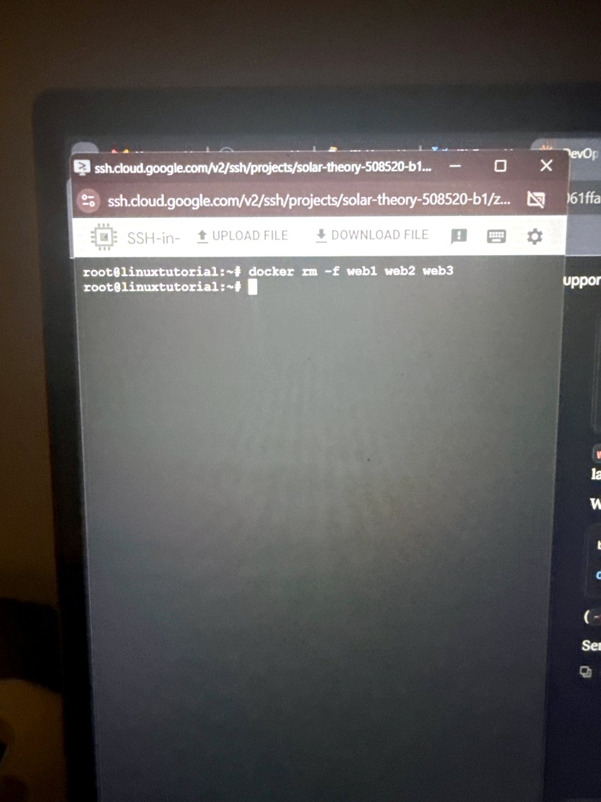
*Figure 5.6: Cleanup. Note that `docker rm` prints nothing on success here, so a clean prompt is the success signal.*

**What this shows:** `docker images` lists **one** `nginx` image while `docker ps` lists **three** containers. A file created in `web1` is **not** in `web2`, because each container has its own writable layer on top of the shared read-only image.

```
Dockerfile → docker build → IMAGE → docker run → CONTAINER

Image     = packaged application template (read-only)
Container = running instance of that image
```

---

### Task 4: Containerise the Flask app

**Commands**
```bash
mkdir ~/student-app
cd ~/student-app
nano app.py
nano requirements.txt
nano Dockerfile
ls -l
cat Dockerfile
```

| Command | What it does |
|---|---|
| `mkdir ~/student-app` | Create a project folder. `~` = my home directory (`/root` as root). I did **not** reuse `/opt/student-app`, to keep the Linux project intact |
| `cd ~/student-app` | Move into it |
| `nano file` | Edit a file. Save `Ctrl+O`, `Enter`; exit `Ctrl+X` |
| `ls -l` | List files with sizes, owners and permissions |
| `cat Dockerfile` | Print the file without risking an accidental edit |

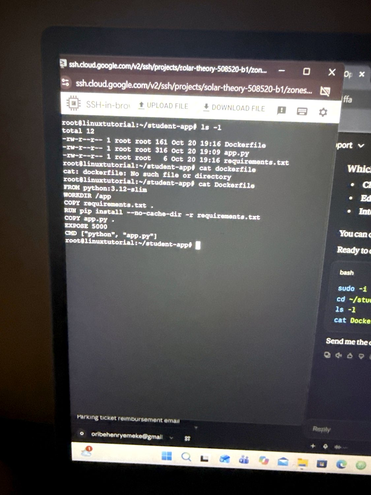
*Figure 5.7: The three files (`Dockerfile` 161 bytes, `app.py` 316 bytes, `requirements.txt` 6 bytes) and the Dockerfile contents. Note `cat dockerfile` (lower-case) failed with "No such file or directory": **Linux file names are case-sensitive**.*

See [section 4](#4-the-project-files-explained-line-by-line) for what every line does. **`RUN` vs `CMD`:** `RUN` executes at **build time** and its result is saved in the image; `CMD` is stored as metadata and executes at **run time**, each time a container starts.

---

### Task 5: Build the image and understand layers and caching

**Commands**
```bash
docker build -t student-app:v1 .
docker images
docker image inspect student-app:v1
docker history student-app:v1
docker build -t student-app:v1 .        # again, nothing changed
nano app.py                              # change the message
docker build -t student-app:v1 .        # again, after the edit
```

| Part | Meaning |
|---|---|
| `docker build` | Ask the daemon to build an image from a Dockerfile |
| `-t student-app:v1` | **Tag** the image: name `student-app`, version `v1` |
| `.` (the final dot) | The **build context**: the folder whose files `COPY` can use. **A space is needed before it** |
| `docker image inspect` | Full JSON about the image |
| `docker history` | Lists the layers, one per instruction, with sizes |

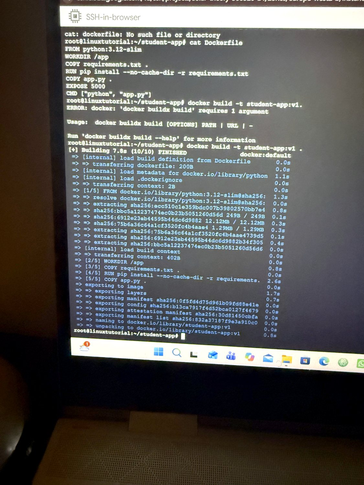
*Figure 5.8: My first attempt `docker build -t student-app:v1.` (no space before the dot) gave `ERROR: 'docker buildx build' requires 1 argument`. The corrected command built in **7.8 s**; `pip install` took **2.6 s**. Nothing says `CACHED` yet because it was the first build. `transferring context: 402B` is the size of the files sent to the daemon.*

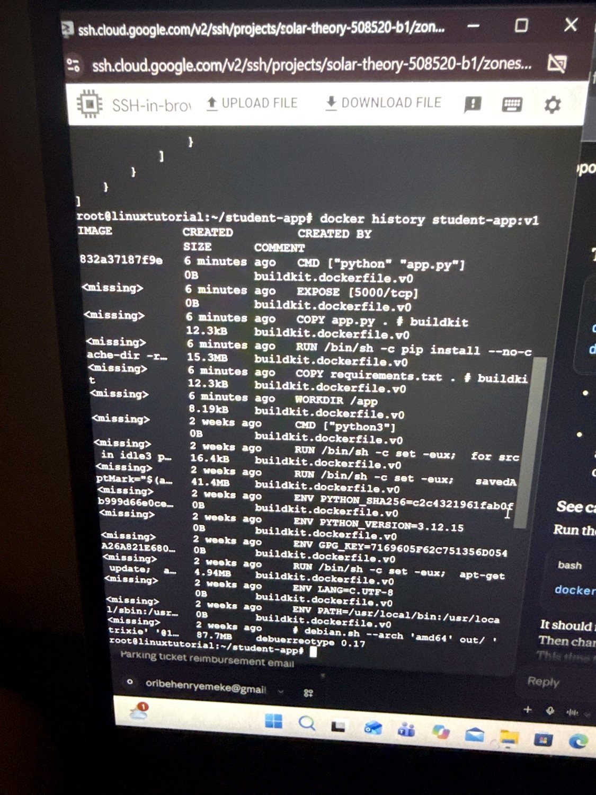
*Figure 5.9: `docker history student-app:v1`. Read from the top (newest): `CMD` 0B, `EXPOSE` 0B, `COPY app.py` 12.3kB, `RUN pip install` **15.3MB**, `COPY requirements.txt` 12.3kB, `WORKDIR /app` 8.19kB. Below those (created "2 weeks ago") are the Python base image's layers, ending in the 87.7MB Debian base.*

| Layer (from my history) | Size | Notes |
|---|---|---|
| `WORKDIR /app` | 8.19 kB | |
| `COPY requirements.txt .` | 12.3 kB | |
| `RUN pip install ...` | **15.3 MB** | Flask and dependencies |
| `COPY app.py .` | 12.3 kB | |
| `EXPOSE 5000/tcp` | 0 B | metadata only |
| `CMD ["python","app.py"]` | 0 B | metadata only |

`<missing>` in the IMAGE column is normal: Docker keeps an ID only for the final image.

**Caching test**

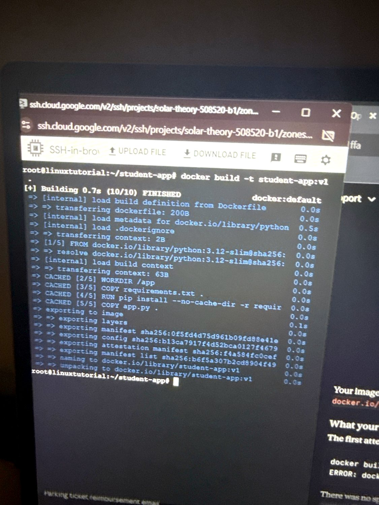
*Figure 5.10: Nothing changed, so steps `[2/5]` to `[5/5]` all say `CACHED`; total **0.7 s** (vs 7.8 s).*

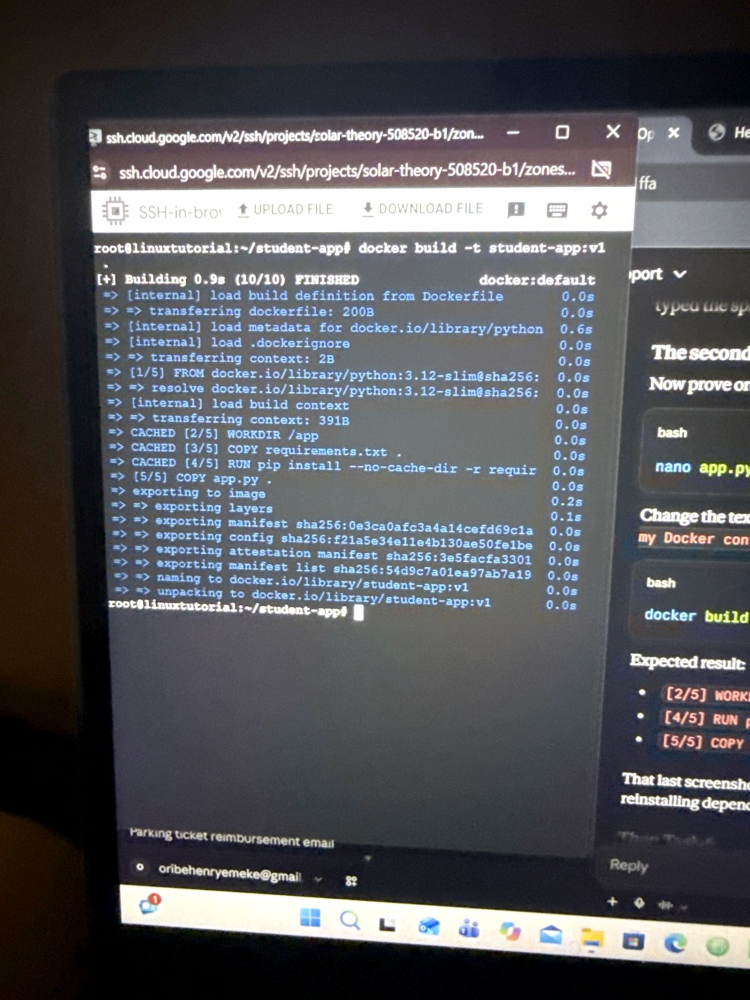
*Figure 5.11: After editing `app.py`, only `COPY app.py` re-ran. `pip install` stayed `CACHED`, so Flask was **not** reinstalled. Build time **0.9 s**. The build context grew from 63B to 391B (my edited file).*

**What to remember**
- **Image layer:** a read-only snapshot of the file changes made by one instruction.
- **Why Docker caches:** if an instruction and everything above it are unchanged, it reuses the saved layer; rebuilds drop from seconds to under a second, and layers (like the Debian base) are shared across images.
- **Why order matters:** a changed layer invalidates every layer after it. So put rarely-changing steps first.
- **Why editing `app.py` does not reinstall dependencies:** `requirements.txt` and the install come **before** `COPY app.py`. If I had written `COPY . .` first, every code edit would reinstall everything.

---

### Task 6: Run the container and publish a port

**Commands**
```bash
docker run -d --name student-app -p 5000:5000 student-app:v1
docker ps
curl http://localhost:5000
curl http://localhost:5000/health
```

| Part | Meaning |
|---|---|
| `-d` | Run in the background |
| `--name student-app` | Name the **container** |
| `-p 5000:5000` | **Publish**: `HOST_PORT:CONTAINER_PORT` |
| `student-app:v1` | The **image** to run |
| `curl URL` | Make an HTTP request and print the response |

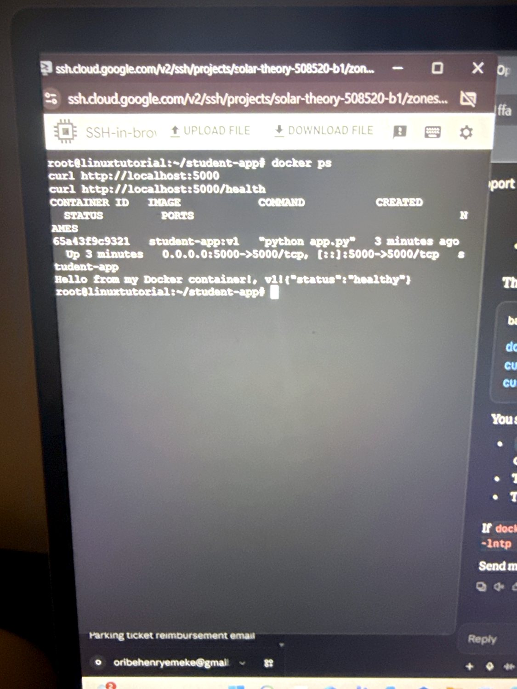
*Figure 5.12: `0.0.0.0:5000->5000/tcp, [::]:5000->5000/tcp` is the port mapping (`HOST_IP:HOST_PORT->CONTAINER_PORT`, then the IPv6 version). Command `"python app.py"` is my Dockerfile's `CMD`. The responses (`Hello from my Docker container!...` and `{"status":"healthy"}`) appear joined because Flask adds no trailing newline.*

```
curl localhost:5000
      ↓
Host port 5000          ← Docker listens here because of -p
      ↓  iptables rules + docker-proxy
Container port 5000     ← Flask listens here (on 0.0.0.0)
      ↓
Flask process
```

**Container name vs image name:** three things were called `student-app`: the container (`--name`), the image (`-t`), and the folder (`mkdir`). In `docker run -d --name student-app -p 5000:5000 student-app:v1` the first is the container, the last is `image:tag`.

---

### Task 7: The container is a Linux process

**Commands**
```bash
docker top student-app
ps aux | grep "app.py"
docker exec -it student-app /bin/sh
#   inside:
ps
hostname
cat /etc/os-release
ls /
cat /proc/1/cmdline
exit
```

| Command | What it does |
|---|---|
| `docker top student-app` | Show the container's processes **as the host sees them** |
| `ps aux \| grep "app.py"` | The same process in the host's own process list |
| `docker exec -it student-app /bin/sh` | Run a shell **inside** the container. `-i` keep input open, `-t` give a terminal. The slim image has `sh`, not `bash` |
| `ps` | **Failed** (`not found`): the slim image has no `ps` tool |
| `hostname` | Prints the container ID (own hostname) |
| `cat /etc/os-release` | The **image's** OS (Debian 13), not the host kernel |
| `ls /` | The container's own filesystem (includes my `/app`) |
| `cat /proc/1/cmdline` | Reads PID 1's command directly from `/proc` since `ps` is missing |

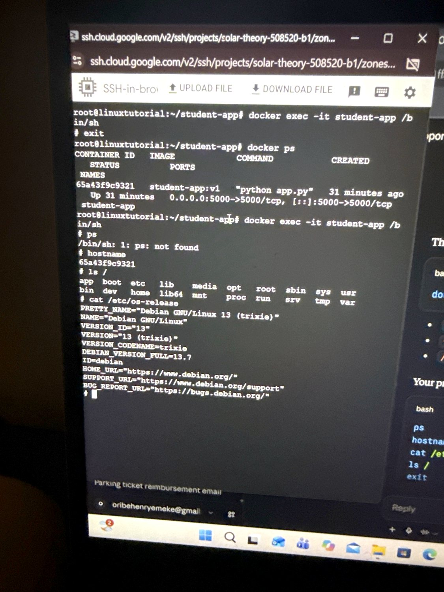
*Figure 5.13: Inside the container. `ps: not found`; `hostname` = `65a43f9c9321` (the same ID as in `docker ps`); `ls /` shows `app` (my `WORKDIR`); `/etc/os-release` shows Debian 13.*

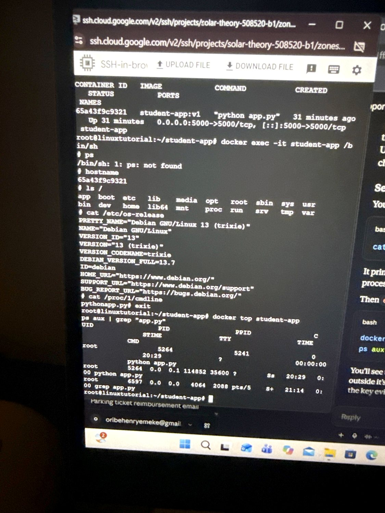
*Figure 5.14: **Inside** the container `python app.py` is **PID 1** (`cat /proc/1/cmdline`). On the **host** the same process is **PID 5264**, parent **5241** (the container runtime shim), user `root`.*

**This is the key proof that a container is not a VM:** one process, two PIDs, because of the PID namespace. Namespaces control what a process can **see** (its own PIDs, hostname, filesystem, network). cgroups control what it can **use** (CPU, memory).

| | Virtual machine | Container |
|---|---|---|
| Kernel | Own guest kernel | Shares the host kernel |
| Start-up | Minutes | Milliseconds to seconds |
| Size | GBs | Tens of MB |
| Isolation by | Hypervisor | Namespaces + cgroups |

Evidence: the NGINX logs earlier showed the **host's** kernel `6.12.x+deb13`.

---

### Task 8: Container networking

**Commands**
```bash
docker network ls
docker network inspect bridge
docker inspect -f '{{range .NetworkSettings.Networks}}{{.IPAddress}}{{end}}' student-app
ip addr | grep -E "docker0|172.17"
curl http://172.17.0.2:5000
```

| Command | What it does |
|---|---|
| `docker network ls` | Lists networks: `bridge` (default), `host`, `none` |
| `docker network inspect bridge` | JSON for the default network, including connected containers and their IPs |
| `docker inspect -f '{{...}}' name` | `-f` formats the output with a Go template; here it prints only the IP |
| `ip addr \| grep -E "docker0\|172.17"` | Show the VM's network interfaces matching those words |
| `curl http://172.17.0.2:5000` | Reach the container **by its private IP** from the VM |

> Note: I first typed `curl http://<container IP>:5000`. The angle brackets `< >` are **placeholders**; bash treats them as redirection and prints `No such file or directory`. Always type the real value.

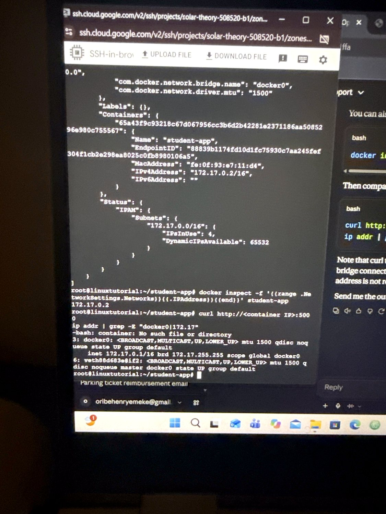
*Figure 5.15: Container `student-app` has **172.17.0.2/16** on subnet **172.17.0.0/16**, bridge name **docker0**. `ip addr` shows `docker0` with `172.17.0.1/16` (the VM's side of the bridge) and a `veth...` interface (a virtual cable into the container).*

| Term | Value | Meaning |
|---|---|---|
| Host IP | the VM's address (private + external) | Where the outside world reaches the VM |
| Container IP | `172.17.0.2` | Private address on the Docker bridge; reachable only from the VM and other containers on that network |
| Host port | `5000` (left of `-p`) | Port the VM listens on |
| Container port | `5000` (right of `-p`) | Port Flask listens on inside the container |

**Why a service on container port 5000 is not reachable from outside by default:** `172.17.0.2` is a private address that only exists inside the VM. `-p` adds iptables rules and a proxy so traffic to the **VM's** port 5000 is forwarded to `172.17.0.2:5000`:

```
Outside client → VM external IP:5000 → Docker rules → 172.17.0.2:5000 → Flask
```

The container IP can change when a container is recreated, which is why Task 14/15 forbid hard-coding it.

---

### Task 9: Environment variables

**Changes to `app.py`:** added `APP_ENV = os.getenv("APP_ENV", "development")` and returned it in the home page.

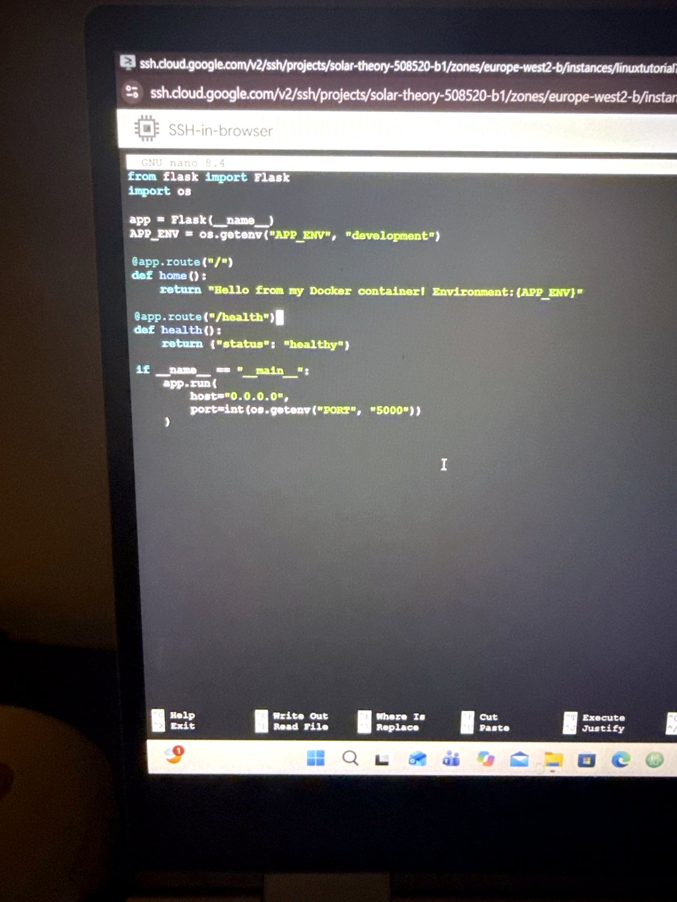
*Figure 5.16: The edited file in nano. (I noticed the return line was missing the `f` before the quote, so `{APP_ENV}` would print literally. Adding the `f` makes it an f-string.)*

**Commands**
```bash
docker build -t student-app:v1 .
docker rm -f student-app
docker run -d --name student-app -p 5000:5000 student-app:v1
sleep 2
curl http://localhost:5000
docker rm -f student-app
docker run -d --name student-app -p 5000:5000 -e APP_ENV=production student-app:v1
sleep 2
curl http://localhost:5000
docker exec student-app env | grep APP_ENV
```

| Part | Meaning |
|---|---|
| `-e APP_ENV=production` | Set an environment variable inside the container at start-up |
| `sleep 2` | Wait 2 seconds so Flask finishes starting |
| `docker exec student-app env` | Run `env` (print all environment variables) inside the container |
| `\| grep APP_ENV` | Show only the matching line |

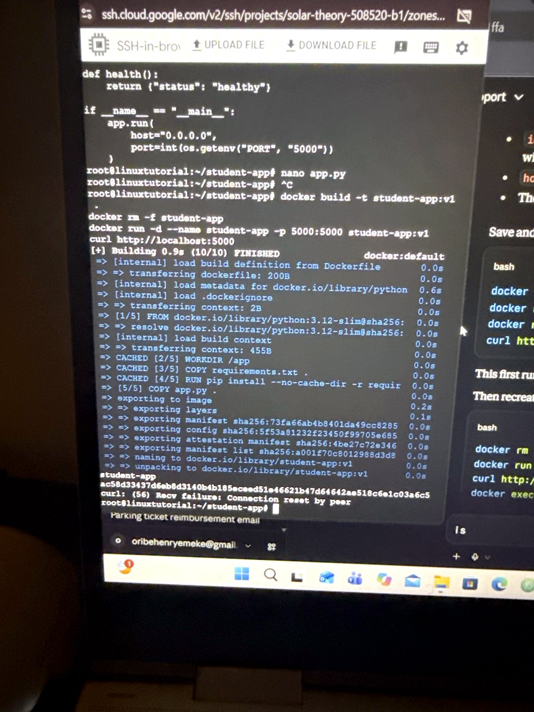
*Figure 5.17: The rebuild kept `pip install` `CACHED`. Then `curl` printed `(56) Recv failure: Connection reset by peer`; I had pasted the commands together so `curl` ran before Flask had started (see section 7).*

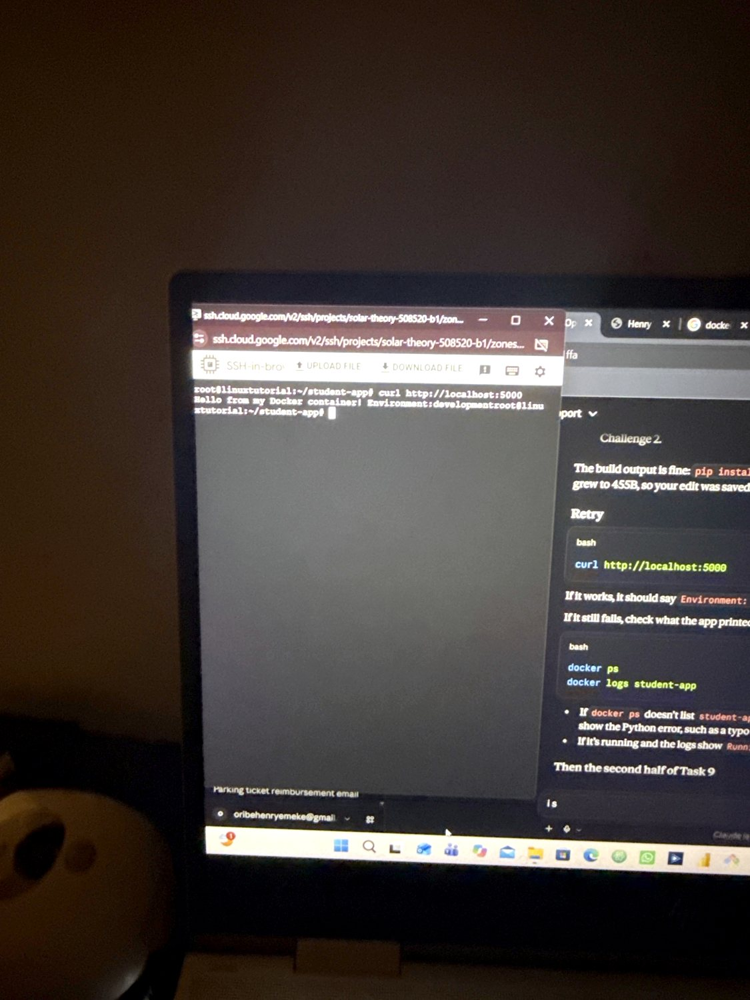
*Figure 5.18: Without `-e`, the app falls back to the default: `Environment:development`.*

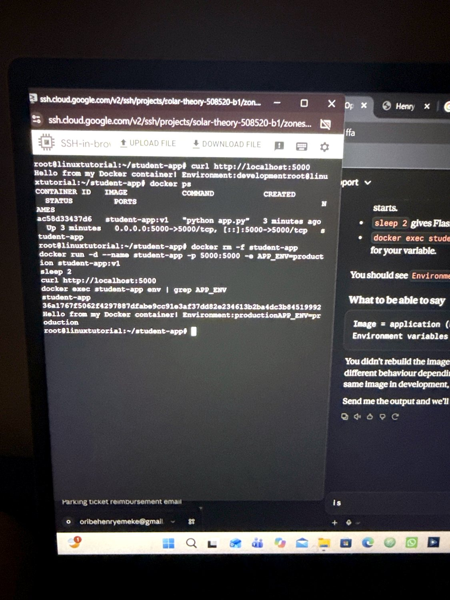
*Figure 5.19: With `-e APP_ENV=production`: `Environment:production`, and `APP_ENV=production` shown from inside the container. The container ID changed because `rm -f` + `run` created a **new** container from the **same image**.*

```
Image = application (built once, unchanged)
Environment variables = runtime configuration (chosen per container)
```

---

### Task 10: Container logs

**Commands**
```bash
docker logs student-app
docker logs -f student-app      # Ctrl+C to stop following
```

| Command | What it does |
|---|---|
| `docker logs student-app` | Print everything the app wrote to stdout/stderr so far |
| `docker logs -f student-app` | **Follow** live (like `journalctl -f`). `Ctrl+C` stops following, **not** the container |

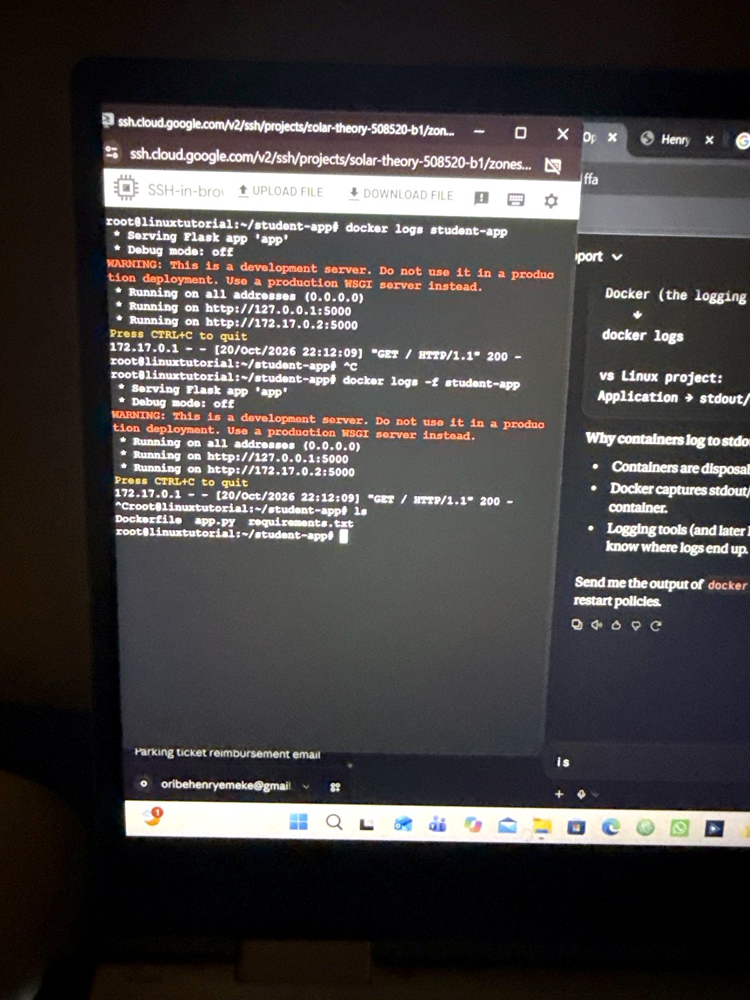
*Figure 5.20: Startup: `Running on all addresses (0.0.0.0)`, `http://127.0.0.1:5000`, `http://172.17.0.2:5000`. Request: `172.17.0.1 - - "GET / HTTP/1.1" 200 -`.*

**Reading the logs**
- Flask listens on `0.0.0.0`, so it accepts traffic on every interface, including `172.17.0.2` (the container's bridge address) where Docker delivers published traffic.
- The client shown is `172.17.0.1`, the `docker0` bridge, because Docker's proxy forwarded my request.
- The red warning says Flask's built-in server is for development; real deployments use a WSGI server such as gunicorn.

```
Container:  App → stdout/stderr → Docker (logging driver) → docker logs
Project 1:  App → stdout/stderr → systemd → journal → journalctl
```

**Why containers log to stdout/stderr:** containers are disposable, so a log file inside one would vanish with it. Docker captures the streams automatically, so one command works for every container and log collectors can gather them.

---

### Task 11: Lifecycle and restart policies

**Commands**
```bash
docker stop student-app
docker ps -a
docker start student-app
docker restart student-app
docker rm -f student-app
docker run -d --name student-app -p 5000:5000 -e APP_ENV=production --restart unless-stopped student-app:v1
docker inspect -f '{{.State.Pid}}' student-app
kill -9 9690
sleep 3
docker ps
docker inspect -f '{{.RestartCount}}' student-app
```

| Part | Meaning |
|---|---|
| `docker restart` | Stop and start the **same** container |
| `--restart unless-stopped` | Restart policy (see below) |
| `docker inspect -f '{{.State.Pid}}'` | Print the **host PID** of the container's main process (`9690`) |
| `kill -9 9690` | Force-kill that process, simulating a crash. `-9` = SIGKILL, cannot be caught |
| `docker inspect -f '{{.RestartCount}}'` | How many times Docker has restarted the container |

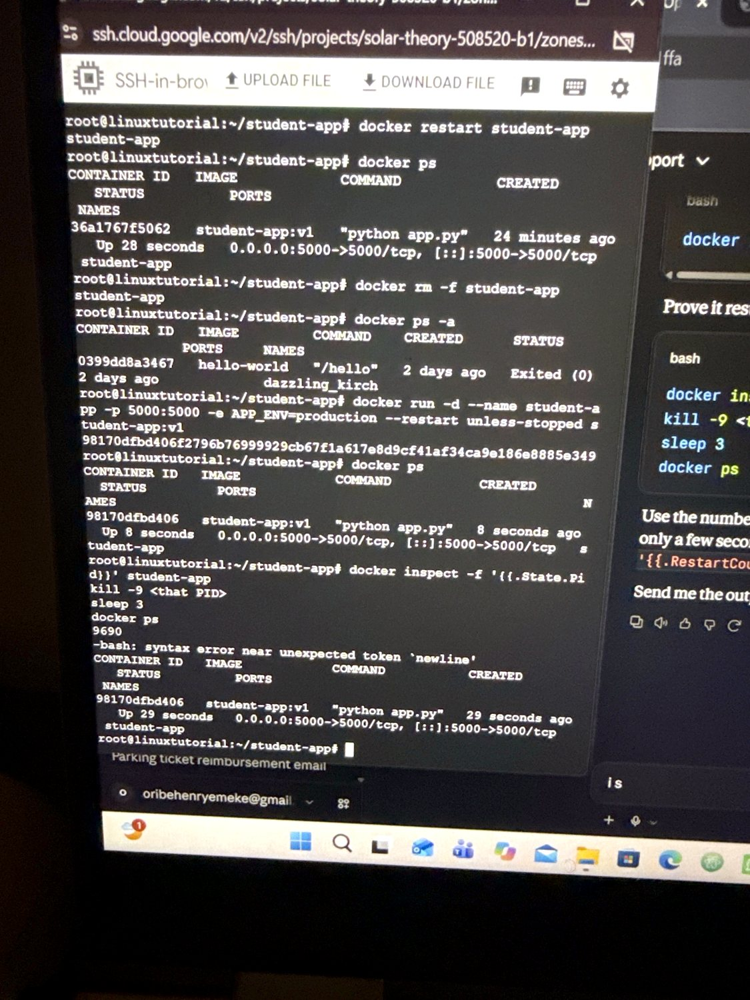
*Figure 5.21: `docker restart` kept the same container (created 24 minutes earlier, `Up 28 seconds`). After recreating with `--restart unless-stopped`, `docker inspect` printed PID **9690**. The `kill -9 <that PID>` line failed with `syntax error near unexpected token 'newline'`: again the `< >` placeholder mistake.*

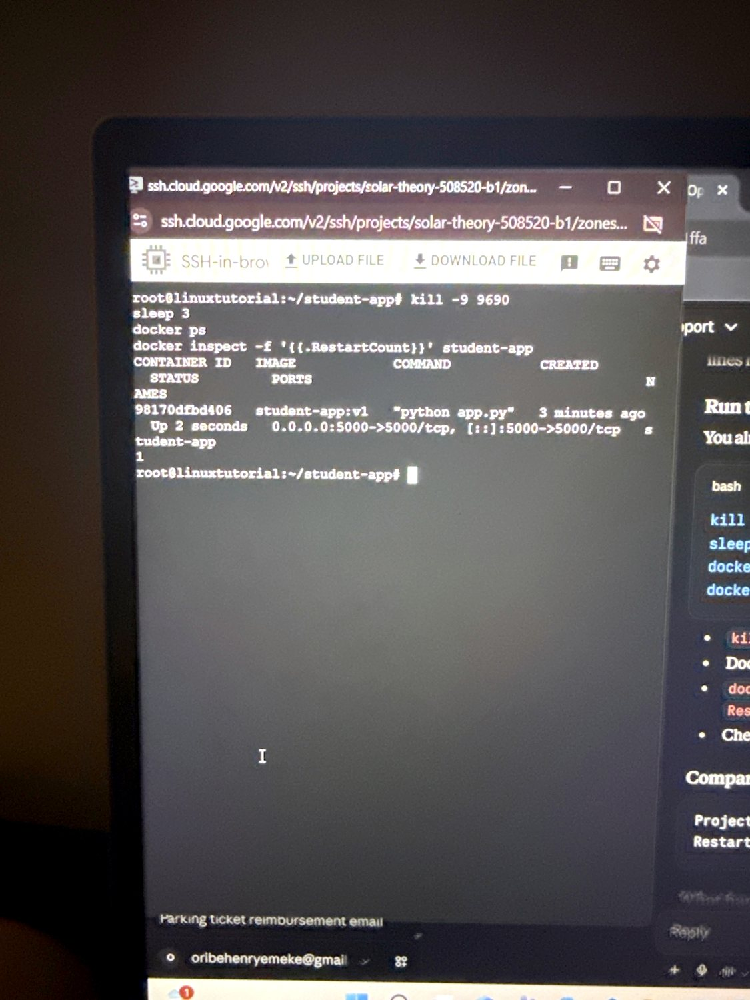
*Figure 5.22: After `kill -9 9690`, the container was created 3 minutes ago but `Up 2 seconds`: Docker **restarted it by itself**. `RestartCount` = **1**.*

```
Project 1 (systemd):  Restart=always
Project 2 (Docker):   --restart unless-stopped
```

| Event | With `--restart unless-stopped` |
|---|---|
| The application crashes | Docker restarts the container |
| I run `docker stop` | It stays stopped, even after a reboot |
| The Docker daemon restarts | The container comes back |
| The server reboots | Docker starts at boot, then restarts the container |

Other policies: `no` (default), `on-failure`, `always` (also restarts a manually stopped container when the daemon restarts).

---

### Task 12: Ephemeral container storage

**Commands**
```bash
docker exec student-app sh -c "echo hello > /tmp/test.txt"
docker exec student-app cat /tmp/test.txt
docker rm -f student-app
docker run -d --name student-app -p 5000:5000 student-app:v1
sleep 2
docker exec student-app cat /tmp/test.txt
```

| Part | Meaning |
|---|---|
| `sh -c "echo hello > /tmp/test.txt"` | Start a tiny shell **inside** the container that writes the word `hello` into a file. (The quotes keep the `>` redirection inside the container instead of on my VM) |
| `cat /tmp/test.txt` | Print the file |
| `docker rm -f` + `docker run` | Delete the container and create a **brand-new** one from the same image |

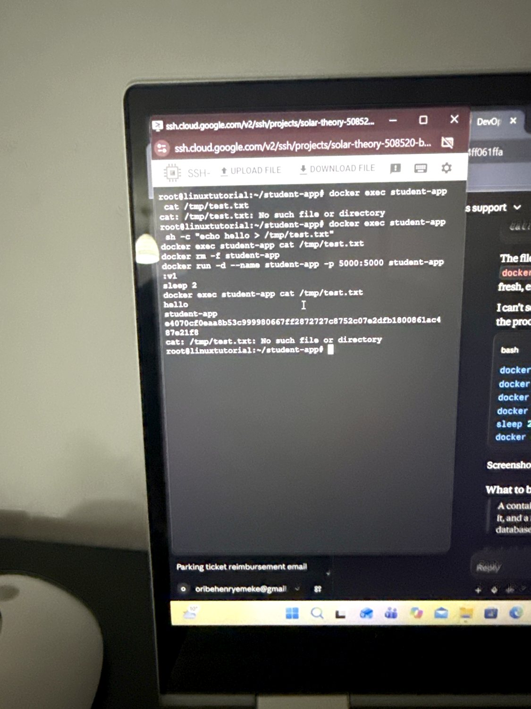
*Figure 5.23: Full test. First `cat` → **hello**. After removing and recreating the container (new ID `e4070cf0eaa8...`), the second `cat` → **No such file or directory**.*

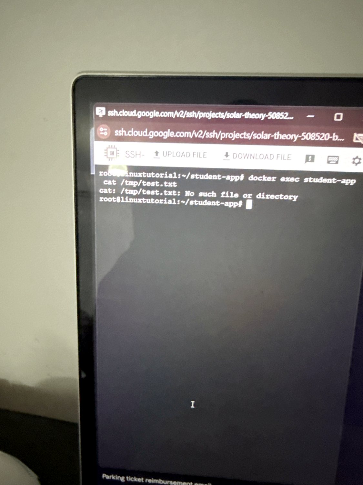
*Figure 5.24: The failing `cat` on its own.*

The file lived in the container's **writable layer**, which is deleted with the container.

> **Containers are disposable. Important data must not depend on a container's own filesystem surviving.**

---

### Task 13: Docker volumes

**Commands**
```bash
docker volume create student-data
docker volume ls
docker volume inspect student-data
docker rm -f student-app
docker run -d --name student-app -p 5000:5000 -v student-data:/data student-app:v1
sleep 2
docker exec student-app sh -c "echo persistent > /data/test.txt"
docker exec student-app cat /data/test.txt
docker rm -f student-app
docker run -d --name student-app -p 5000:5000 -v student-data:/data student-app:v1
sleep 2
docker exec student-app cat /data/test.txt
cat /var/lib/docker/volumes/student-data/_data/test.txt
```

| Part | Meaning |
|---|---|
| `docker volume create student-data` | Create storage managed by Docker, independent of any container |
| `docker volume inspect` | Shows `Mountpoint: /var/lib/docker/volumes/student-data/_data`, a real folder on the VM |
| `-v student-data:/data` | `VOLUME_NAME:PATH_INSIDE_CONTAINER`. Anything written to `/data` goes into the volume |
| `cat /var/lib/docker/volumes/.../test.txt` | Read the same file **from the host**, with no container involved |

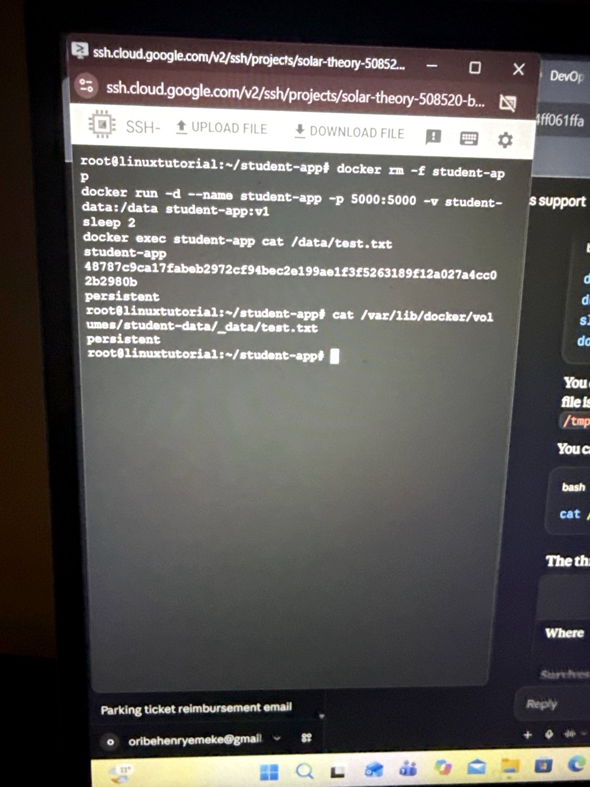
*Figure 5.25: The container was deleted and recreated (new ID `48787c9ca17f...`), yet `cat /data/test.txt` still prints **persistent**, and the same file is readable directly from `/var/lib/docker/volumes/student-data/_data/test.txt` on the host.*

| | Container writable layer | Docker volume | Bind mount |
|---|---|---|---|
| Lives | Inside the container | Managed by Docker, `/var/lib/docker/volumes/...` | A host path I choose |
| Survives `docker rm` | **No** | **Yes** | **Yes** |
| Syntax | (default) | `-v student-data:/data` | `-v /root/data:/data` |
| Best for | Temporary scratch files | App data, databases | Config files, source code in development |

If the left side of `-v` is a **name** it is a volume; if it is a **path starting with `/`** it is a bind mount.

---

### Tasks 14 and 15: NGINX container, custom network and DNS

**Commands**
```bash
docker run -d --name nginx-test -p 80:80 nginx
curl http://localhost
docker inspect -f '{{range .NetworkSettings.Networks}}{{.IPAddress}}{{end}}' student-app
docker rm -f nginx-test
docker network create student-network
docker network ls
docker rm -f student-app
docker run -d --name student-app --network student-network -e APP_ENV=production --restart unless-stopped -v student-data:/data student-app:v1
docker run --rm --network student-network curlimages/curl curl -s http://student-app:5000
```

| Command | What it does |
|---|---|
| `docker run -d --name nginx-test -p 80:80 nginx` | Run NGINX alone with port 80 published; `curl` shows the default welcome page. It does not know about Flask yet |
| `docker inspect -f ... student-app` | Look up Flask's current IP (`172.17.0.2`): the address I must **not** hard-code |
| `docker network create student-network` | Create a **user-defined bridge network** with built-in DNS |
| `--network student-network` | Join the container to that network |
| No `-p` on `student-app` | Flask is no longer published to the host (Task 16) |
| `docker run --rm --network ... curlimages/curl curl -s http://student-app:5000` | A throw-away helper container on the same network that calls Flask **by name**. `--rm` deletes it when it finishes |

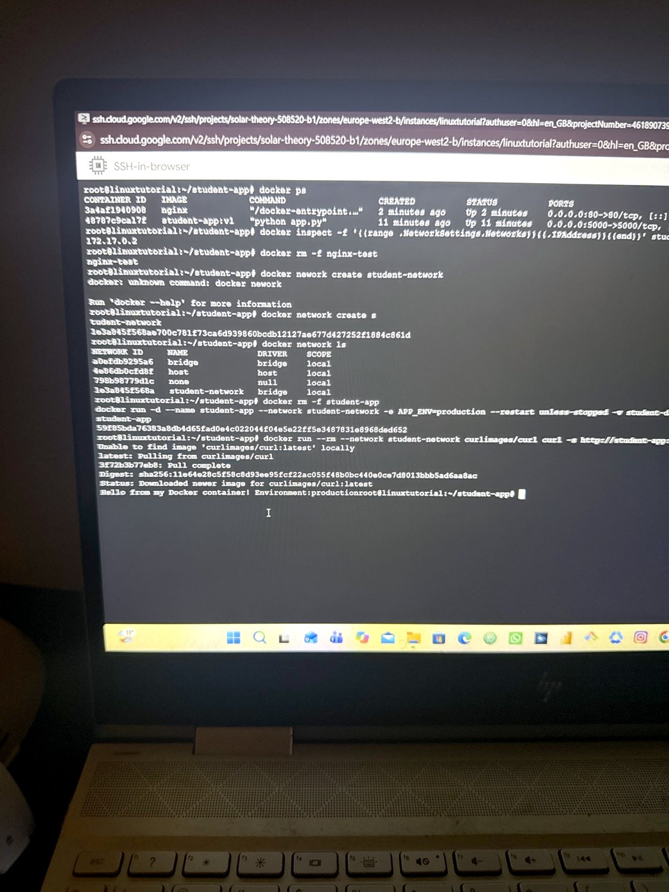
*Figure 5.26: `docker network create` first failed with `unknown command: docker nework` (a typo), then worked; `docker network ls` lists `bridge`, `host`, `none` and **student-network**. The last line proves DNS: `curl http://student-app:5000` returned **Hello from my Docker container! Environment:production** with **no IP address** typed anywhere.*

**How NGINX resolves `student-app`:** on a user-defined network each container uses Docker's embedded DNS server at `127.0.0.11`. It maps container names to their **current** IPs. The default `bridge` network has no name resolution.

**The NGINX config** (bind-mounted, see section 4.4):

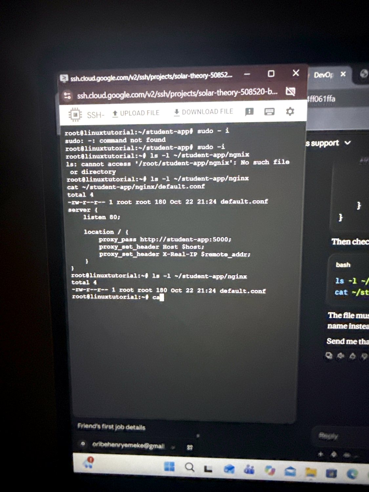
*Figure 5.27: `default.conf` (180 bytes) containing `proxy_pass http://student-app:5000;`. (Typos on screen: `sudo - i` with a stray space failed; `ngnix` instead of `nginx` failed; both were retried correctly.)*

---

### Task 16: Expose only NGINX

**Commands**
```bash
docker run -d --name nginx --network student-network -p 80:80 \
  -v /root/student-app/nginx/default.conf:/etc/nginx/conf.d/default.conf:ro \
  --restart unless-stopped nginx
sleep 2
docker ps
curl http://localhost
curl http://localhost:5000
```

| Part | Meaning |
|---|---|
| `\` at the end of a line | Continue the command on the next line |
| `--network student-network` | Same network as Flask so DNS works |
| `-p 80:80` | Publish **only** NGINX to the host |
| `-v /root/student-app/nginx/default.conf:/etc/nginx/conf.d/default.conf:ro` | **Bind mount**: my file appears inside the container as its site config. `:ro` = read-only. The path must be **absolute**, and the file must **exist first** or Docker creates a *folder* with that name |
| `--restart unless-stopped` | Survive crashes and reboots |

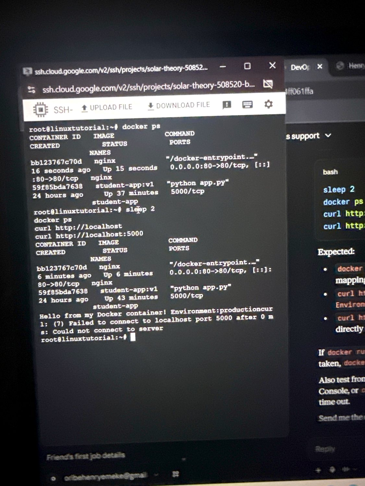
*Figure 5.28: `nginx` shows `0.0.0.0:80->80/tcp`, while `student-app` shows **only `5000/tcp`** (no host mapping). `curl http://localhost` → **Hello from my Docker container! Environment:production** (through NGINX). `curl http://localhost:5000` → **`curl: (7) Failed to connect ... Could not connect to server`**: Flask is **not directly exposed**.*

**This failure is the success condition.** `curl (7)` means *connection refused*: nothing listens on that host port. Compare with `curl (56)` *connection reset*: the port **is** published but the backend is not ready.

---

### Task 17: Docker Compose

**Commands**
```bash
docker rm -f nginx student-app
docker network rm student-network
docker ps -a ; docker network ls ; docker volume ls
cd ~/student-app
nano compose.yaml
docker compose config
docker compose up -d --build
docker compose ps
docker compose logs
curl http://localhost
docker compose down
docker compose ps
docker volume ls
docker compose up -d
```

| Command | What it does |
|---|---|
| `docker rm -f nginx student-app` | Remove the hand-made containers (Compose will make its own with the same names) |
| `docker network rm student-network` | Remove the hand-made network. It said `network student-network not found`, meaning it was already gone, which is harmless |
| `docker compose config` | **Validate** `compose.yaml` and print the resolved version; catches YAML indentation errors |
| `docker compose up -d --build` | Build images for `build:` services, pull `image:` services, create the network and volume, start the containers in `depends_on` order, in the background |
| `docker compose ps` | List this project's containers |
| `docker compose logs` | Combined logs of all services (`-f` to follow) |
| `docker compose down` | Stop and remove the containers and the network. **Named volumes are kept** (use `-v` to delete them) |

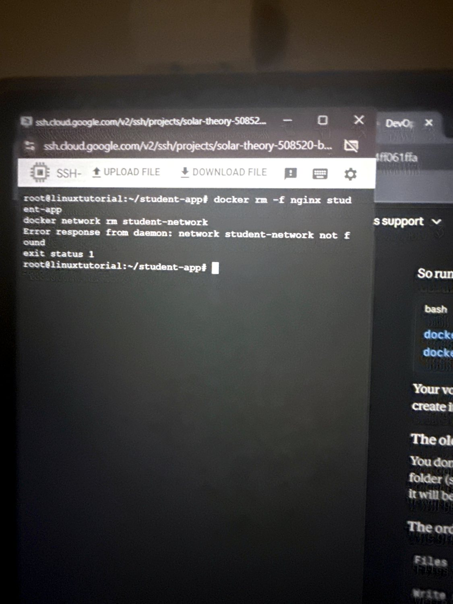
*Figure 5.29: The cleanup. The "not found" error just means the network was already removed.*

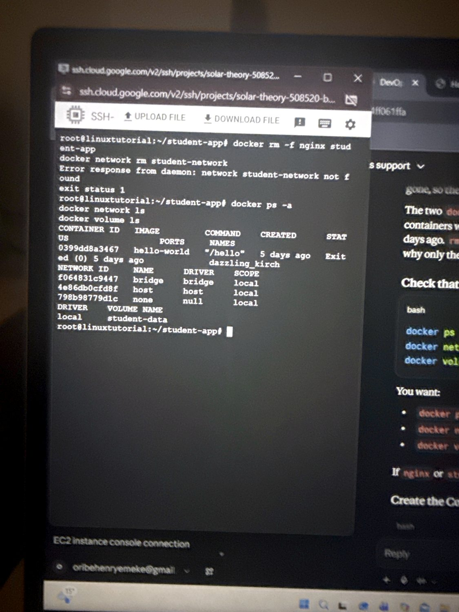
*Figure 5.30: A clean slate: only the old `hello-world` container, only the default networks, and the volume `student-data` still exists.*

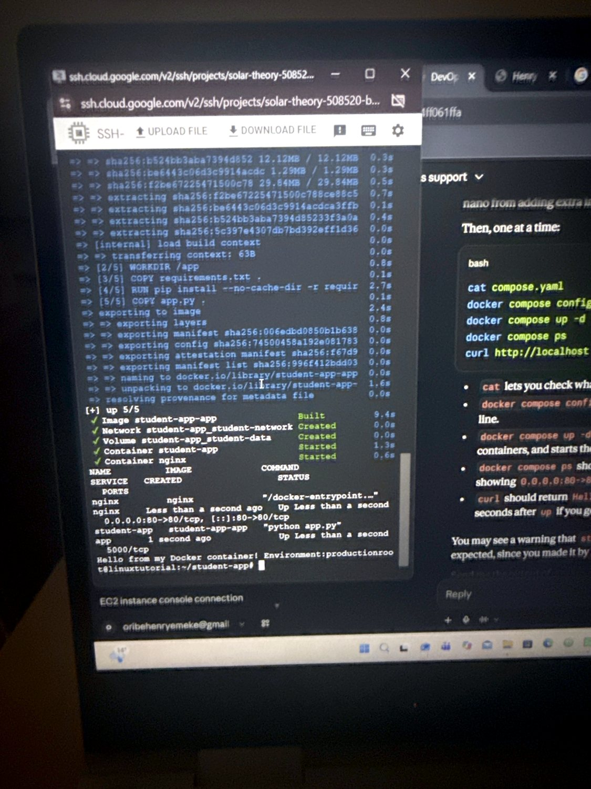
*Figure 5.31: `docker compose up -d --build`. Summary `[+] up 5/5`: **Image student-app-app Built**, **Network student-app_student-network Created**, **Volume student-app_student-data Created**, **Container student-app Started**, **Container nginx Started**. `docker compose ps` shows `nginx` with `0.0.0.0:80->80/tcp` and `student-app` with only `5000/tcp`. `curl` returned **Hello from my Docker container! Environment:production**.*

**Notes on Compose behaviour**
- Compose **builds** `app` (`build: .`) and **pulls** `nginx` (`image: nginx`).
- Names get the project-folder prefix (`student-app_...`). Because of this, Compose made a new volume `student-app_student-data` rather than reusing my hand-made `student-data`. Adding `external: true` would reuse the old one, but then `docker compose up` fails on any machine where that volume was not created first, so this repo keeps the simple default.
- `down` followed by `up` recreates everything from the one file.

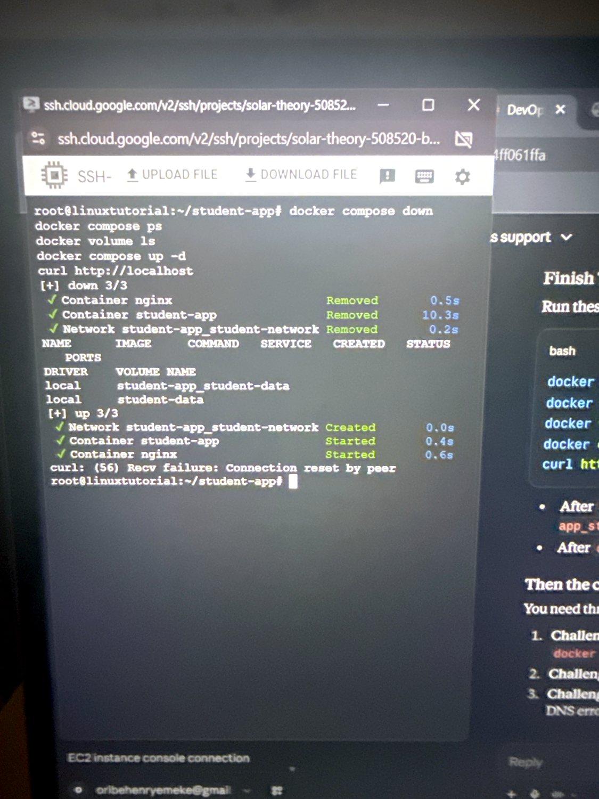
*Figure 5.32: `docker compose down` removed `nginx`, `student-app` and the network (`student-app` took 10.3 s because Docker waits up to 10 s for a graceful stop). `docker volume ls` still lists **`student-app_student-data`** and **`student-data`**: **volumes survive `down`**. `docker compose up -d` recreated everything. The `curl` printed `(56) Connection reset by peer` because it ran before Flask was ready.*

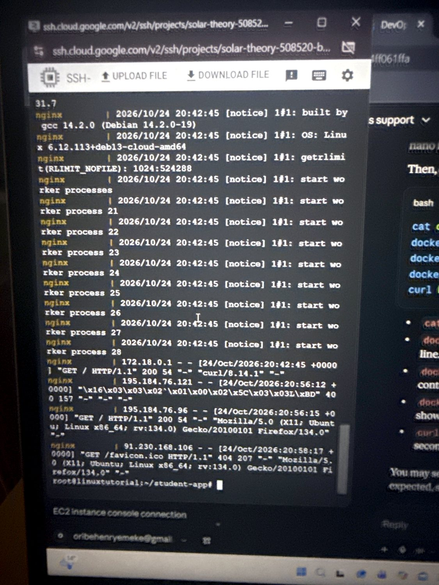
*Figure 5.33: NGINX access logs. `172.18.0.1 ... "curl/8.14.1"` is my own request (172.18.x is the custom network's gateway). The other lines come from **internet scanners**: `195.184.76.121` sent a TLS handshake (`\x16\x03\x03...`) to a plain-HTTP port and got `400`; `195.184.76.96` and `91.230.168.106` requested `/` and `/favicon.ico`.*

**Security lesson from the scanner traffic:** within minutes of opening port 80 to the internet, bots probed the server. This is normal background noise, and it is why **only the reverse proxy is published** and Flask is not. In production I would add HTTPS, a non-root `USER` in the Dockerfile, a production WSGI server (gunicorn) and firewall allow-lists.

**Why Compose beats many `docker run` commands**
- One versionable, reviewable file instead of commands lost in terminal history.
- Repeatable: `docker compose up -d` recreates the same system anywhere.
- It also creates the network and volume, orders start-up and wires services together.
- Recreating a container with `docker run` means retyping **every** option; Compose remembers them.

---

## 6. Linux project vs Docker project

```
DIRECTLY ON LINUX                  WITH DOCKER

Install Python                     Pull/build image
      ↓                                 ↓
Create venv                        Create container
      ↓                                 ↓
Install dependencies               Dependencies packaged in image
      ↓                                 ↓
Run Python process                 Run container process
      ↓                                 ↓
systemd                            Docker restart policy
      ↓                                 ↓
journalctl                         docker logs
      ↓                                 ↓
Host networking                    Container networking
      ↓                                 ↓
/opt/student-app                   Container filesystem
```

| Concern | Linux project | Docker project |
|---|---|---|
| Packaging | Install Python and a venv on the host | Dependencies baked into the image |
| Process management | `systemd` (`Restart=always`) | Docker restart policy (`unless-stopped`) |
| Logs | `journalctl -u student-app` | `docker logs student-app` |
| App listens on | `127.0.0.1:5000` | `0.0.0.0:5000` inside the container |
| Reverse proxy | NGINX on the host → `127.0.0.1:5000` | NGINX container → `student-app:5000` by DNS |
| Files | `/opt/student-app` | Container filesystem + volumes |
| Isolation | Dedicated `appuser` + file permissions | Namespaces and cgroups |
| Reproducibility | Manual steps on each server | Image + `compose.yaml` |

> **The critical lesson:** Docker did not make Linux disappear. The Flask app is still a Linux process (PID 5264 on the host). Docker packages and isolates it.

---

## 7. Troubleshooting

### 7.1 Real problems I hit, and the fixes

Every one of these actually happened during the project.

| # | Symptom | Cause | Fix |
|---|---|---|---|
| 1 | Browser: `ERR_CONNECTION_TIMED_OUT` on the VM IP | No GCP firewall rule for port 80 | Create `allow-http` (`tcp:80`, tag `http-server`) and tick *Allow HTTP traffic* on the VM |
| 2 | `appuser is not in the sudoers file` | `appuser` is deliberately unprivileged | Do admin tasks as root / my sudo user, not `appuser` |
| 3 | Instructions assumed Ubuntu | VM is Debian 13 | Use `download.docker.com/linux/debian` |
| 4 | `cat dockerfile` → No such file or directory | Linux file names are **case-sensitive** | `cat Dockerfile` |
| 5 | `docker build -t student-app:v1.` → `'docker buildx build' requires 1 argument` | No space before the `.` build context | `docker build -t student-app:v1 .` |
| 6 | `curl: (56) Recv failure: Connection reset by peer` right after `docker run` / `compose up` | Port mapping was open but Flask had not started yet | Wait (`sleep 2`) and retry |
| 7 | `ps: not found` inside the container | The slim image has no `ps` | `cat /proc/1/cmdline`, or `docker top` from the host |
| 8 | `bash: container: No such file or directory` and `syntax error near unexpected token 'newline'` | I typed placeholders `<container IP>` / `<that PID>`; `<` `>` are shell redirection | Type the real value (`172.17.0.2`, `9690`) |
| 9 | `docker nework create` → `unknown command` | Typo | `docker network create` |
| 10 | `sudo - i` → command not found | Stray space | `sudo -i` |
| 11 | `ls ~/student-app/ngnix` → No such file | Typo (`ngnix`) | `nginx` |
| 12 | The editor showed a "Netrw Directory Listing" | I was in vim's file browser instead of nano | `Esc`, then `:q` (or `:q!`) to leave |
| 13 | `docker network rm student-network` → not found | Network already removed | Harmless; confirm with `docker network ls` |
| 14 | Compose created a **new** volume instead of reusing `student-data` | Compose prefixes names with the project name | Accept the prefixed name (used here, so the repo runs on any machine), or add `external: true` if a volume already exists |

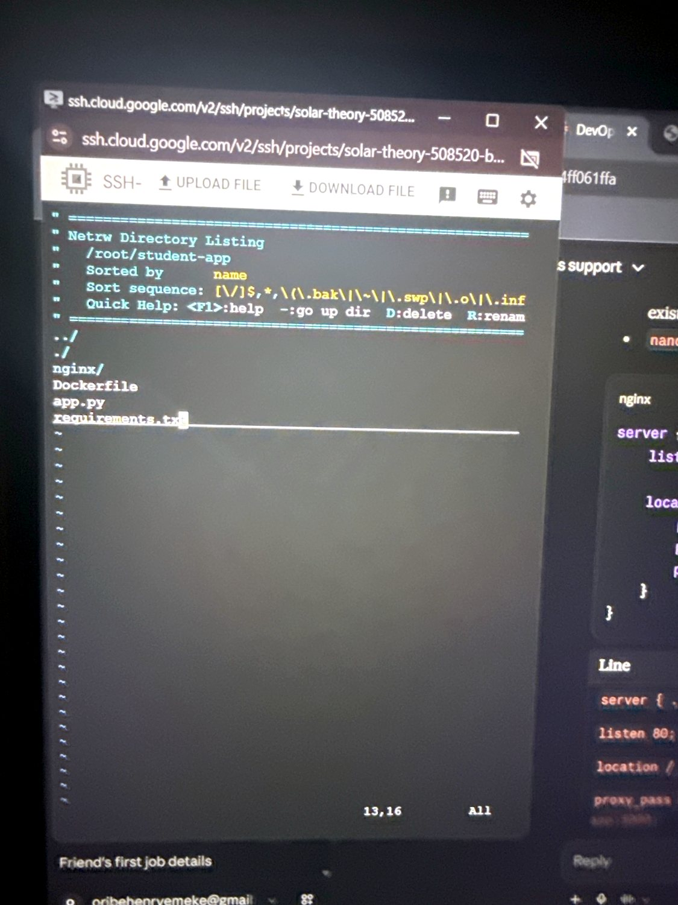
*Figure 7.1: Problem 12. The vim directory browser. To leave: `Esc`, then `:q` and `Enter` (`:q!` quits without saving).*

**Useful diagnostic distinctions I learned**

| Error | What it means |
|---|---|
| `curl: (7) Failed to connect` | Nothing is listening on that host port (not published, or service down) |
| `curl: (56) Connection reset by peer` | The port is published but the backend is not ready or not listening on the right address |
| Browser timeout | The packets never reached the VM (firewall) |
| `502 Bad Gateway` | NGINX is up but cannot get a response from its upstream |
| `Exited (0)` / `Exited (1)` | Clean exit vs error exit |

### 7.2 Troubleshooting challenges from the brief

> **Status:** The commands and expected results for each challenge are documented below. Live screenshots are added as I run each challenge. Challenge 7 is already evidenced by Tasks 12 and 13.

#### Challenge 1: Application container crashes

**Break it:** add `raise Exception("boom")` at the top of `app.py`, rebuild, run.
```bash
docker compose up -d --build
docker ps
docker ps -a
docker logs student-app
docker inspect -f '{{.State.ExitCode}} {{.State.Error}}' student-app
```
- `docker ps` does not list it; `docker ps -a` shows `Exited (1)`.
- `docker logs` shows the Python traceback: the cause.
- **Fix:** remove the error line and rebuild.
- **Lesson:** `docker ps -a` + `docker logs` first. Exit code `0` = clean, non-zero = error. With `unless-stopped` it may restart-loop; check `RestartCount`.


#### Challenge 2: Port mapping failure

```bash
docker rm -f student-app
docker run -d --name student-app student-app:v1     # no -p
curl localhost:5000                                 # curl: (7) Failed to connect
docker ps                                           # shows 5000/tcp only
```
- Cause: Flask runs, but nothing on the host listens on 5000 because the port was **never published**. It is reachable only via the container IP (`172.17.x.x`) from the VM.
- Fix: recreate with `-p 5000:5000`.
- Lesson: `EXPOSE` is documentation; `-p` publishes.


#### Challenge 3: Port conflict

```bash
docker run -d --name app1 -p 5000:5000 student-app:v1
docker run -d --name app2 -p 5000:5000 student-app:v1
# Bind for 0.0.0.0:5000 failed: port is already allocated
docker run -d --name app2 -p 5001:5000 student-app:v1     # works
```
- Many containers can listen on 5000 **inside** because each has its own network namespace. The **host** port is shared and only one listener can bind a given IP:port.
- Fix: a different host port (`5001:5000`) or a reverse proxy.


#### Challenge 4: Flask listening on 127.0.0.1

Change to `app.run(host="127.0.0.1", port=5000)`, rebuild, run with `-p 5000:5000`.
```bash
curl localhost:5000        # fails (connection reset / empty reply)
docker logs student-app    # shows Running on http://127.0.0.1:5000 only
```
- Cause: inside the container `127.0.0.1` is the container's own loopback. Docker forwards published traffic to the container's `eth0` address, where nothing listens.
- Fix: `host="0.0.0.0"`, rebuild, rerun.
- Lesson: publishing a port is not enough; the app must listen on an interface Docker can reach.

> Do not confuse this with the `curl (56)` I saw in Figures 5.17 and 5.32. Those were timing (Flask not started yet), not a loopback problem.


#### Challenge 5: Container DNS failure

In `nginx/default.conf` change `student-app` to `student-api`.
```bash
docker compose restart nginx
docker compose logs nginx
docker exec nginx getent hosts student-app     # resolves
docker exec nginx getent hosts student-api     # no output
```
- Cause: Docker DNS knows only the **container/service names** on that network. `student-api` does not exist.
- Result: NGINX logs `host not found in upstream "student-api"` and exits, or returns `502`.
- Fix: restore `student-app`, restart NGINX.


#### Challenge 6: NGINX 502 Bad Gateway

```bash
docker compose stop app
curl -i http://localhost                  # HTTP/1.1 502 Bad Gateway
docker compose logs nginx --tail 5
docker compose start app
curl http://localhost
```

Troubleshoot outside in:
```
Is NGINX running?                 docker compose ps
        ↓
Can NGINX resolve the app?        docker exec nginx getent hosts student-app
        ↓
Is the app container running?     docker ps -a ; docker logs student-app
        ↓
Is port 5000 listening?           check the app logs for "Running on ...:5000"
        ↓
Can NGINX reach it?               docker exec nginx wget -qO- http://student-app:5000
```
Cause: NGINX is healthy but its upstream (Flask) is down or unreachable.


#### Challenge 7: Data disappears

I already demonstrated this in **Task 12** (Figures 5.23, 5.24), and the redesign with a volume in **Task 13** (Figure 5.25). Create data in `/tmp` → delete the container → data gone. Redesign: mount a volume at `/data` and write there.

#### Challenge 8: Broken Dockerfile (build time vs run time)

- **Build-time failure:** `COPY missing.txt .` → `docker build` fails immediately; no image is produced.
- **Run-time failure:** `CMD ["python", "wrong.py"]` → the image builds fine, but the container exits at once; `docker logs` shows `can't open file '/app/wrong.py'`.
```bash
docker build -t student-app:bad .
docker run -d --name bad student-app:bad
docker ps -a
docker logs bad
```
| | Build time | Run time |
|---|---|---|
| Triggered by | `docker build` (`FROM`, `COPY`, `RUN`) | `docker run` (`CMD`, env, ports) |
| Symptom | Build stops with an error; no image | Image exists; container exits or misbehaves |
| Where to look | Build output | `docker ps -a`, `docker logs` |


---

## 8. Command cheat sheet

| Area | Commands |
|---|---|
| Daemon | `docker --version`, `docker info`, `systemctl status docker`, `ps aux \| grep dockerd`, `ls -l /var/run/docker.sock` |
| Images | `docker images`, `docker build -t name:tag .`, `docker history name:tag`, `docker image inspect name:tag`, `docker rmi name:tag` |
| Run | `docker run -d --name N -p H:C -e K=V -v vol:/path --network NET --restart unless-stopped IMAGE` |
| Lifecycle | `docker ps`, `docker ps -a`, `docker stop`, `docker start`, `docker restart`, `docker rm`, `docker rm -f` |
| Inspect | `docker inspect`, `docker inspect -f '{{.State.Pid}}' N`, `docker top N`, `docker exec -it N /bin/sh`, `docker logs -f N` |
| Networks | `docker network ls`, `docker network create`, `docker network inspect`, `docker network rm` |
| Volumes | `docker volume create`, `docker volume ls`, `docker volume inspect`, `docker volume rm` |
| Compose | `docker compose config`, `up -d --build`, `ps`, `logs -f`, `stop`, `start`, `restart`, `down`, `down -v` |
| Linux helpers | `ss -lntp`, `ps aux`, `systemctl status/stop/disable`, `journalctl -u`, `curl -i URL`, `cat /etc/os-release` |

---

## 9. Glossary

| Term | Plain-language meaning |
|---|---|
| **Container** | An isolated Linux process running from an image |
| **Image** | A read-only, layered template used to create containers |
| **Layer** | One saved set of filesystem changes from a Dockerfile instruction |
| **Registry / Docker Hub** | Online store of images (where `nginx`, `python` are pulled from) |
| **Tag** | A version label on an image (`v1`, `latest`) |
| **Daemon (`dockerd`)** | The background service that does Docker's work |
| **CLI** | The `docker` command; a client of the daemon |
| **Socket (`docker.sock`)** | A special file used for local communication between CLI and daemon |
| **Build context** | The folder sent to the daemon during `docker build` (the `.`) |
| **Port publishing (`-p`)** | Forwarding a host port to a container port |
| **Bridge network** | A virtual switch connecting containers on the VM (`docker0`) |
| **Docker DNS** | Built-in name resolution on user-defined networks (`127.0.0.11`) |
| **Volume** | Docker-managed persistent storage |
| **Bind mount** | A specific host file/folder mapped into a container |
| **Namespace** | Kernel feature giving a process its own view (PIDs, network, mounts, hostname) |
| **cgroup** | Kernel feature limiting resource usage (CPU, memory) |
| **Reverse proxy** | A server (NGINX) that forwards client requests to backend servers |
| **Compose** | Tool to define and run multi-container apps from one YAML file |
| **Upstream** | The backend server a proxy forwards to (here: Flask) |

---

*Next project: the same application on Kubernetes: Pods, Deployments, Services, ConfigMaps, Secrets, health probes, persistent storage, Ingress, scaling and self-healing.*
